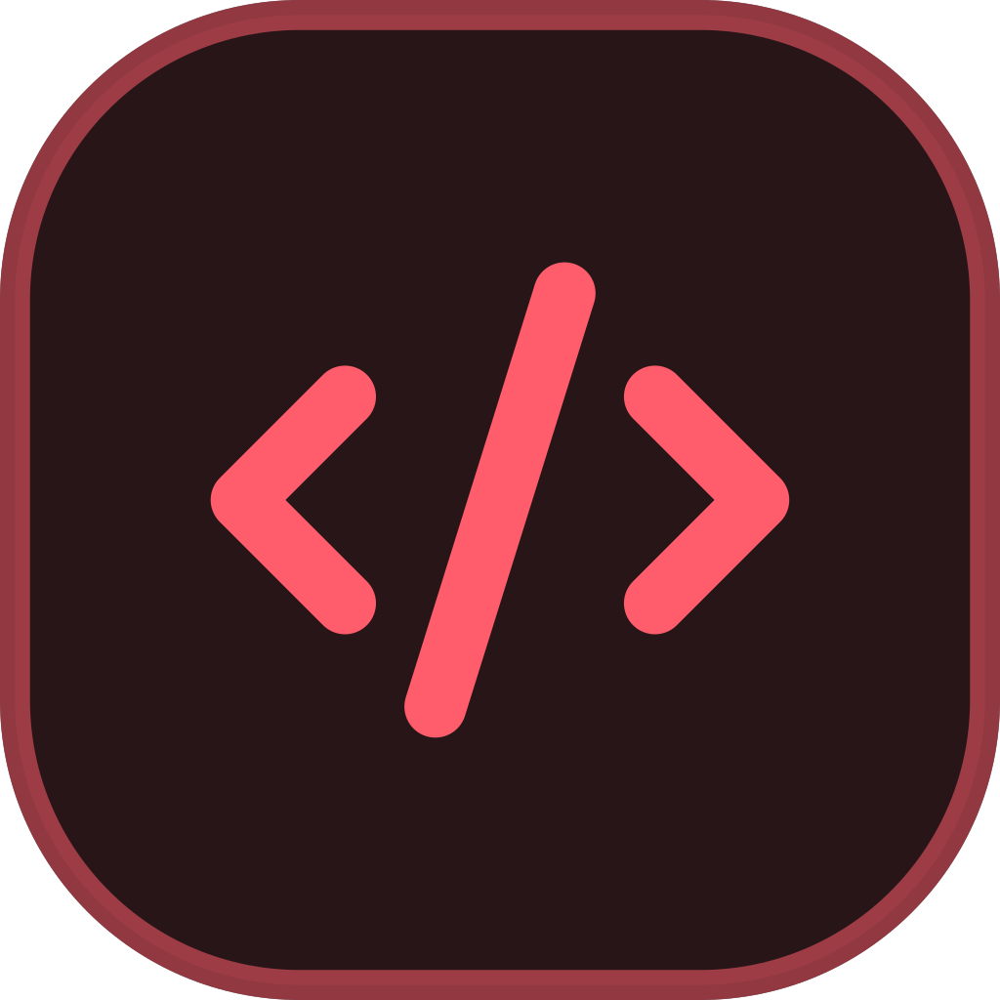
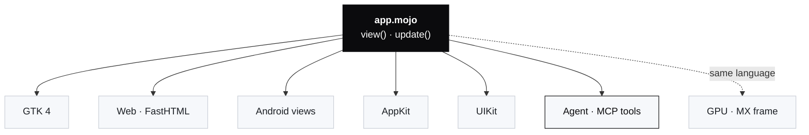

<p align="center">
  
</p>

<h1 align="center">omxcode</h1>

<p align="center">
  <b>One readable language, from button to kernel.</b><br>
  One Mojo file. Every screen. The GPU underneath. Agents built in.
</p>

<p align="center">
  <a href="https://abhisheksreesaila.github.io/omxcode/"><b>See it in action → abhisheksreesaila.github.io/omxcode</b></a>
</p>

<p align="center">
  <a href="LICENSE"></a>
  
  
  
  <a href="https://abhisheksreesaila.github.io/omxcode/"></a>
</p>

<p align="center">
  
  <br><sub>omxplorer, written in Mojo with omxcode: a million orders, every tile and chart recomputed in 0.3 ms on the GPU. A native Linux window.</sub>
</p>

<table>
<tr>
<td width="33%"></td>
<td width="33%"></td>
<td width="33%" align="center"></td>
</tr>
<tr>
<td><sub>20 million points, 1.5 ms a frame on the GPU</sub></td>
<td><sub>A dashboard over 20 million rows, 6–9 ms a click</sub></td>
<td align="center"><sub>The same Mojo, as real Android views</sub></td>
</tr>
</table>

---

Imagine writing an app once, in a language that reads like Python.

It opens as a real app on Linux, in the browser, on Android, on a Mac and on an iPhone. Each one uses that platform's own buttons, menus and text fields, not an imitation of them. The heavy lifting, a million rows summed, sorted or charted, runs on the GPU, in the same language and the same file. And when an AI agent wants to use the app, it doesn't scrape pixels or guess at buttons. The app is already a set of tools the agent can call.

That's **omxcode**. Its showcase, **omxplorer**, is a data app in the spirit of Numbers and Power BI, and the app itself is one Mojo file of about 4,500 lines, built from the framework's components.

## Why omxcode exists
1. **No boundary tax.** No JSON, no HTTP, no second process to start, keep alive and debug. Apps that move a lot of data between the screen and the computing are faster and simpler.
2. **One language from pixels to GPU kernels.** Mojo writes the interface and the CUDA-class kernels. In omxplorer, the group-by kernel sits in the same codebase as the sheet that shows its totals.
3. **Every app can be driven by an agent.** omxcode has an [agent host](docs/agent.md), so each app can be operated by an agent through the same code that draws its screens. JS apps need that built in separately.
4. **Native on every device from one codebase.** Linux and the Mac run today (Mac checks run on GitHub's macOS runners); the web, Android and iPhone are next ([where it stands](#where-it-stands)).

**Where to start, and where not yet:** start with apps that move a lot of data: analytics, spreadsheets, video, documents, robotics. For forms, CRUD screens and marketing sites, JS wins today on ecosystem alone; when a JS library is the better tool, embed it as a widget inside omxcode. SaaS building blocks (sign-in, accounts, payments) are on the roadmap.

## What it feels like

### The sentence is the interface

In omxplorer a chart's title isn't a label. It *is* the chart:

> **Sum** of **revenue** by **product**, **largest first**, **top 5**, **every row**, as **bars**

Every coloured word is a setting: tap it and pick another. Or type into the ask field: *"median"*, *"by month, as a line"*, *"only paid and over 5,000"*. The sentence rewrites itself, and the bars animate to the new answer. A person, a keyboard and an agent all edit the same sentence.

<p align="center">
  
  <br><sub>1,000,000 rows. The chart answered "revenue by product, largest first, top 5" in 0.7 ms on an RTX 3090. The inspector on the right shows the same sentence as four pages: Data, Order, Rows, Style.</sub>
</p>

### It shows its work

Every answer says how long it took and where it ran ("0.7 ms on NVIDIA GeForce RTX 3090"). A tile says what it's made of ("p50 exact", "of 1,000,000 values"). And when you ask for something it can't do, it tells you what it skipped instead of quietly guessing. For example, "under 2.5" on a whole-number column, or a second number condition, is left out and named.

### It's quiet

The toolbar only inserts things; the inspector sets them up, and shows only the settings that apply. One accent colour per mode (green for the sheet, red for the report). Motion is short and springy: hover and press in 150 ms or less, tiles in 320 ms, and nothing overshoots.

## Agent native, from the first line

Most apps meet AI agents through the screen: screenshots, pixel coordinates, an accessibility tree written for screen readers, or an API someone added later. omxcode takes a different route. **The agent is a host**, the same way GTK and the browser are.

The view tree that GTK turns into widgets and the web turns into HTML, the agent host turns into **tools** ([docs/agent.md](docs/agent.md)):

- **No per-app work.** A button's tag names its tool, its tooltip describes it, and tapping it is calling it. A menu item becomes `file-save`. A text field becomes a tool that takes `text`. Every app built with omxcode is an MCP server already (55 of 121 components are proven through the agent so far; the matrix below has the rest).
- **An agent can do nothing a person couldn't.** A disabled button is no tool. A dialog's buttons are tools only while it is open. The screen is the permission model.
- **It gets back what changed, in words.** It doesn't have to compare two screenshots. Each call returns the new texts, what opened or closed, and the tools that appeared or went.
- **It reads, not just clicks.** `read` gives the screen's text grouped by area, or a grid's rows as tab-separated text. `render` gives a drawn view as a PNG for agents that can see.
- **The same sentence.** The chart sentence a person taps is the one the agent asks. There's no separate agent API to drift out of date.

This is a real session, run today against omxplorer and a 1M-row file. It uses no screenshots and no coordinates:

```text
→ choose-a-file  {"path": "orders_1m.csv"}
→ create-table
→ insert-chart
→ ask            {"text": "revenue by product, largest first, top 5", "submit": true}
← Did ask.
  Now: chart0: 0.6 ms
  Now: inspector: Sum of revenue by product, largest first, top 5, every row, as bars
  Now: status-bar: Took revenue · by product · largest first · top 5
→ read
← menubar: orders_1m · 1,000,000 rows
  menubar: ● NVIDIA GeForce RTX 3090 · ready
  status-bar: Rows 1,000,000 · Columns 12 · Sum 114,007,922.00 …
```

Give any omxcode app to Claude Code with one command:

```bash
scripts/agent.sh omxplorer     # prints: claude mcp add omxplorer -- pixi run python mojoui/hosts/agent.py build/omxplorer/web
```

The charts speak an agent's language too. They are [Flint](https://microsoft.github.io/flint-chart/) specs, the chart format Microsoft designed for AI agents. omxcode draws them natively, and the same specs run through Flint's own renderer as a cross-check.

Agents can also answer with screens. An omxcode app is an [AG-UI](https://docs.ag-ui.com) client: an agent streams a screen as data built from 38 components, and the app checks it and draws it natively while it arrives (`AgentChat`, [the walkthrough](https://abhisheksreesaila.github.io/omxcode/agents.html)). How compatibility is checked, with a command for each claim: [docs/ag-ui-compatibility.md](docs/ag-ui-compatibility.md).

> [!NOTE]
> **What the agent can't do yet:** read a chart's figures as text (it reads the sentence and can `render` the picture), read a drawn grid's cells in apps other than omxplorer, or drag objects on a page.

## Under the hood

The choices, and why each was made.



| Layer | Choice | Why |
|---|---|---|
| **Language** | **Mojo** for the app, the UI framework and the GPU code | Reads like Python, compiles to native code, and runs the same functions on the GPU. One language from button to kernel. |
| **App model** | `view()` describes the screen from state; `update(event)` changes it | The model of Elm, SwiftUI and React. Hosts patch only what changed: after a sheet opens, an edit rebuilds **at most 15 widgets**. |
| **Native controls** | GTK 4 · HTML · Android views · AppKit · UIKit | The platform's own look, keyboard, text input and screen reader. Mojo calls C and Objective-C directly, with no binding generator. |
| **Drawn views** | A **Scene**: a display list in keyed layers, replayed as GPU render nodes (GTK today) | A 1M-row grid at 2180×1074 px scrolls at **0.8 ms p95 a frame**, against 14.2 ms for painted pixels: 18–75× cheaper, 0 texture uploads. |
| **Data engine** | **MX frame**, a Mojo dataframe engine on the GPU | Sum, median and p90 per group, number conditions, calendar groups. **100M rows** (a 4 GB table) stream from disk and **open in 0.2 s**. |
| **Web** | **FastHTML** server; HTMX patches the page | One app state per tab, shared GPU data per process, no app JavaScript. |
| **Agent** | A hand-written **MCP** server over the same module the web serves | The view tree becomes tools; see above. |
| **Charts** | **Flint** specs, drawn natively | One chart language for people, agents and every host. |
| **Looks** | Themes as plugins (`themes/`): Liquid, Ledger, Graphite, Blueprint, Fluent, Omarchy, Paper | The framework names no theme (a check proves it). With no theme, an app looks like its platform. |
| **Proof** | `scripts/check`: every goal, re-run on GTK, in Chromium and on the Android emulator | Results compared with pyarrow, pixels diffed, real input used. A goal isn't done until the reviewer passes it. |

### Measured

<p>
  
  
  
  
</p>

All on one Linux machine with an RTX 3090, and all from the checks or their benchmarks.

**Benchmarks:** omxcode against plain JS, JS + WebGPU and Rust (wasm and native) on one particle field, every table, caveat and line of code: [docs/benchmarks.md](docs/benchmarks.md).

| What | Time |
|---|---|
| A chart over 1M rows (sum by group) | **0.5–0.7 ms** |
| A median per group over 1M rows | **6.4 ms** |
| The status bar's sum and average over 1M rows | **0.3 ms** |
| Scrolling the 1M-row grid, per frame (p95) | **0.8 ms** |
| The Data Lens: 20M points counted and coloured, one 1080p frame | **1.5 ms** (130 ms on the CPU, same pixels) |
| A Power BI-style dashboard re-aggregating 20M rows per click | **6–9 ms** |
| Opening a 100M-row file, streamed | **0.2 s** |

> [!NOTE]
> **The honest edge:** at 100M rows in memory a median chart takes about 0.7 s, and today the window waits for it. Moving that work off the UI thread is next.

## Where it stands

**Runs** means a script runs it on that platform. **Builds** means it builds but no check runs it there yet. The full matrix is generated from the code: [docs/components.md](docs/components.md).

| Host | Runs | Builds | Notes |
|---|---|---|---|
| **Linux** (GTK 4) | 78 | 1 | Every component, gesture and theme; omxplorer's home |
| **Web** (FastHTML) | 79 | 0 | The same results as Linux, checked in Chromium |
| **Agent** (MCP) | 29 | 17 | Every app, no per-app work |
| **Android** (views over JNI) | 19 | 16 | runs the classic controls on the emulator; the newer ones are still to come |
| **Mac** (AppKit) | 0 | 60 | Builds and signs; not proven by a check yet |
| **iPhone** (UIKit) | 0 | 61 | Builds and signs; not proven by a check yet |

The GPU path is NVIDIA today. Apple and phone GPUs use the CPU path, which runs the same functions.

### omxconsole: which models it runs

omxconsole, the second app, runs models on your own GPU through [MAX](https://www.modular.com/max), in the spirit of Ollama and LM Studio. The app and its daemon are Mojo (`examples/console`, `examples/consoled`). Python appears only as programs the daemon starts: `max serve`, Modular's skill scripts and Claude Code.

| Kind of model | Status |
|---|---|
| **An LLM that MAX already supports** | ✅ Pull it, serve it, chat with it, benchmark it |
| **An LLM that MAX can't run yet** ("Port it", beta) | ✅ Built. Claude Code writes a MAX architecture for it, starting from the closest one MAX has, then checks that its output matches Hugging Face. On the owner's machine, 8 of 14 models ported and served, all of them 1 to 3 billion parameters. On the Mojo daemon, gpt2 ported end to end on 2026-11-08: 16 minutes, the second attempt matched Hugging Face, then it served through the app's own API. |
| **A PyTorch model that isn't an LLM** (ResNet, SAM, YOLO, robot policies) | ❌ Not in the console. The framework can run some through PyTorch inside the app (`mojoui/visionmodel.mojo`: OWLv2, SAM 2), but nothing is converted to MAX yet ([the research](docs/research/visionmodel-spike.md)) |
| **scikit-learn and other classic models** | ❌ Not started |

Not yet: `consoled port-try`, the agent's own "see it run" loop, which the Python version had.

### omxconsole: notebooks and tools for agents (new)

- **📓 Run in Jupyter.** Every model has a notebook: its architecture from `config.json`, its model card, and cells that call your endpoint. The Notebook tab's Run in Jupyter writes it to `~/.mxc/notebooks/<model>.ipynb` (never overwriting your edits) and starts JupyterLab on 127.0.0.1 with its own token. The kernels get `MXC_BASE_URL` and a key that lasts as long as the app, so the cells just run. Without `jupyter` on your PATH it runs one through `pixi exec`, installing nothing; `MXC_JUPYTER` picks your own. Jupyter stops when the app closes.
- **🤖 `omxc`, tools for agents.** A small command shipped beside the app (`examples/consoled/omxc.mojo`). Each command is one call to omxconsole's admin API, and it prints the JSON reply as it is: a thin pass-through, not another CLI on top of MAX. A coding agent such as Claude Code can find, pull, serve and port models itself while you watch the same state in the app.

```
./omxc help                                   # every command, for you or your agent
./omxc search smollm                          # models that fit this GPU
./omxc pull HuggingFaceTB/SmolLM2-135M-Instruct --wait
./omxc serve qwen2.5-0.5b                     # answers once MAX serves it
./omxc chat qwen2.5-0.5b "Say hello in five words."
./omxc keys create my-app                     # a key for an app; shown once
./omxc notebook qwen2.5-0.5b                  # Jupyter's link to the model's notebook
```

Exit codes: 0 done, 1 refused or failed (the JSON says why), 2 usage, 3 omxconsole isn't running. `MXC_PORT` points it at another daemon.

**Why Mojo, honestly.** Mojo is young (1.2). It has a small ecosystem, no official iPhone, Android or WebAssembly target (omxcode cross-compiles with two hand-written runtime functions), and no Windows release yet. Flutter, React Native and the Rust kits are far ahead on maturity, tooling and production users. What none of them has is one readable language from the button to the GPU kernel, with native controls on every platform and an agent built in as a host.

## Try it

You need x86-64 Linux with GTK 4 and libadwaita 1.7+, [pixi](https://pixi.sh), and an NVIDIA GPU for the GPU path and the models (without one, the CPU path runs the same code).

```bash
git clone https://github.com/abhisheksreesaila/omxcode && cd omxcode
scripts/setup                                  # the env, omxplorer, the robot demo data, the models
scripts/omxplorer.sh build/demo/fleet.csv      # omxplorer, native window, with 2,000 robot episodes
scripts/omxplorer.sh web                       # the same app at http://127.0.0.1:5001
```

`scripts/setup` prints each step and its time, and skips what's done, so running it again is quick. The demo data is a slice of [DROID](https://droid-dataset.github.io/) (CC-BY-4.0) fetched from the Hugging Face Hub; the models are built from their makers' weights. To plug in your own PyTorch model as a script function, see [Add your own model](https://abhisheksreesaila.github.io/omxcode/models.html).

> [!TIP]
> Insert → Chart, then type into its ask field: *median*, *by month, as a line*, or *only paid and over 5,000*. Or tap any coloured word in the chart's title.

The smallest app is one file (trimmed from `examples/hello/app.mojo`):

```mojo
struct Main(App):
    var clicks: Int

    def update(mut self, event: Event):
        if event.message == GREET:
            self.clicks += 1

    def view(self) -> View:
        return VStack(
            Text("Hello, Ada! (" + String(self.clicks) + ")", style=TITLE),
            Button("Greet", on_tap=GREET, style=PROMINENT),
        )
```

`scripts/build.sh hello all` turns it into a GTK app, a web app, a Mac app and an iPhone app; `scripts/build.sh hello android` makes the APK.

## Read more

- **Tutorials:** [your first app](https://abhisheksreesaila.github.io/omxcode/start.html), then [a todo app](https://abhisheksreesaila.github.io/omxcode/tasks.html) that keeps its tasks in SQLite (`examples/tasks`), then [add your own model](https://abhisheksreesaila.github.io/omxcode/models.html) as a script function. Or all of it, from a button to agents and the GPU, [in slides](https://abhisheksreesaila.github.io/omxcode/learn/).
- **[Reference](docs/reference.md):** the app model, every component, layout, the GPU canvas, the examples.
- **[How it works](docs/architecture.md):** the view tree, the update loop, how each platform is reached.
- **[The agent host](docs/agent.md):** the tools, what an agent gets back, what it can't do yet.
- **[Components × platforms](docs/components.md):** what exists where, generated from the code.
- **[llms.txt](https://abhisheksreesaila.github.io/omxcode/llms.txt):** these docs for an agent; [llms-full.txt](https://abhisheksreesaila.github.io/omxcode/llms-full.txt) is all of them in one file.
- **[Decisions](docs/decisions.md):** every one, with reasons.
- **[Experiments](EXPERIMENTS.md)** and the **[goal reports](docs/goals/):** what was tried, what broke, what was learned. The latest is [docs/report.md](docs/report.md).
- **[The long view](ROADMAP.md):** the original vision.
- **[Gallery](https://abhisheksreesaila.github.io/omxcode/gallery/):** the earlier showcases (analytics, the Workbook, the Data Lens).

## License

MIT: see [LICENSE](LICENSE). Vendored third-party files keep their own licences: HTMX (BSD 0-Clause) and Lucide icons (ISC), in `mojoui/hosts/static/`. See [NOTICE](NOTICE) for MAX and Mojo.

Mojo and MAX are trademarks of Modular Inc.; omxlabs is an independent project, not affiliated with or endorsed by Modular.
