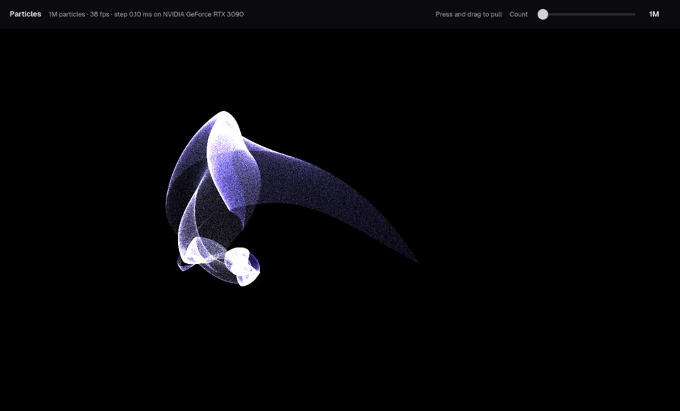

# Benchmarks: one particle field, four ways

The details behind the scoreboard on [the omxcode site](https://abhisheksreesaila.github.io/omxcode/) and [why.html](https://abhisheksreesaila.github.io/omxcode/why.html): every table, every caveat, the method, the code side by side and the effort counts. Nothing here is new; it is taken from [why-details.html](https://abhisheksreesaila.github.io/omxcode/why-details.html) (written by `scripts/why_tables.py`) and the measurement's own reports, [`goals/36/results-desktop.md`](goals/36/results-desktop.md) and [`goals/36/results.md`](goals/36/results.md). Where omxcode loses, this page says so.

The same app, up to twenty million particles pulled by your pointer, built in plain JavaScript, JavaScript + WebGPU, JavaScript + Rust, and omxcode. Then measured on one machine, counted line by line, and handed to an agent.

- [The scoreboard](#the-scoreboard)
- [1 · Performance](#1--performance)
- [2 · The code](#2--the-code)
- [3 · The agent's view](#3--the-agents-view)
- [4 · Features](#4--features)
- [Every caveat](#every-caveat-from-the-measurement-itself)
- [Provenance](#provenance)

## The short read

- **20M particles**, the largest size tested, with omxcode's frames averaging under 16.7 ms (60 fps) and the slowest one in twenty under 20 ms. Measured with vsync off on a real desktop (Hyprland on Wayland, GPU-composited), every field 1280 × 720 pixels. JS + WebGPU and Rust + wgpu (native, offscreen) do it too.
- **258 app lines** in 1 Mojo file for omxcode, plus 1307 framework lines (and 437 test lines) goals 36 and 36b added for it: PointCloud's step and draw, the GPU-to-screen hand-over and GPU blending, reusable by any app. JS + WebGPU: 522 lines, 8 files, 5 languages. JS + Rust is two apps: 374 lines, 10 files, 8 languages for wasm; 771, 6 and 3 for native.
- **1.23 ms** an omxcode frame at 1M. JS + WebGPU takes 1.21 ms and native Rust + wgpu (offscreen) 0.34 ms: Rust + wgpu (native, offscreen) is faster at 1M; the tables say where omxcode is ahead.

## The scoreboard

Lower is better unless the row says otherwise. ✓ marks the winner; = marks a tie (within the runs' spread). "Rust native" is Rust + wgpu timed offscreen; in a window the compositor caps it at 60 fps (below).

| Test | Plain JS | JS + WebGPU | JS + Rust/wasm | Rust native | omxcode | Winner |
|---|---|---|---|---|---|---|
| Frame · 1M particles (ms) | 13.88 | 1.21 = | 1.86 | **0.34 ✓** | 1.23 = | Native Rust; omxcode ties JS + WebGPU |
| Frame · 2M (ms) | 25.06 | 1.24 = | 3.51 | **0.64 ✓** | 1.31 = | Native Rust; omxcode ties JS + WebGPU |
| Frame · 5M (ms) | 57.27 | **1.35 ✓** | 16.67 | 1.52 | 1.57 | JS + WebGPU |
| Frame · 20M (ms) | 217.70 | **3.01 ✓** | 53.45 | 5.99 | 3.13 | JS + WebGPU; omxcode ~2× faster than native Rust |
| Holds 60 fps up to (largest size tested is 20M) | 100k | 20M = | 2M | 20M = | 20M = | Three-way tie |
| GPU step · 20M (ms; the JS and wasm steps run on the CPU) | 71.2 | 0.774 = | 34.3 | 0.771 = | 0.762 = | Tie |
| Cold start · 1M (ms to the first frame) | 792 | 974 | 1,129 | **211 ✓** | 461 | Native Rust |
| Peak memory · 1M (MB) | 612 | 588 | 870 | **146 ✓** | 294 | Native Rust |
| App code (lines) | **243 ✓** | 522 | 374 | 771 | 258 | Plain JS, by 15 |
| Files · languages | 3 · 4 | 8 · 5 | 10 · 8 | 6 · 3 | **1 · 1 ✓** | omxcode |
| Agent tools, built in (every button and slider) | no | no | no | no | **yes ✓** | omxcode |

Rows won: Native Rust 4, JS + WebGPU 2, omxcode 2, Plain JS 1, ties 2. Everyone wins something. Only omxcode holds 60 fps at 20M from one file in one language.

## 1 · Performance

**JavaScript runs out of frames. The usual fixes add languages.**

Every build follows one spec (`showcase/SPEC.md`) and matches the same NumPy reference within 1e-3 after 120 steps.

**How they were written.** Each by its own agent from its stack's official docs, under a contract that said not to read the other builds. Git can't show what an agent read; it shows that JS + WebGPU, omxcode and JS + Rust were committed at 22:57, 22:58 and 23:24 on 27 October, each commit touching only its own folders (omxcode's also the framework and one test), all before any measurement. A reviewer then looked for performance mistakes in each, and every build got fixes: JS + WebGPU stopped waiting on the GPU every frame; omxcode's skip of saturated pixels was modelled on JS + WebGPU's, and JS + WebGPU later got omxcode's load-first form of it; JS + Rust got its own thread-count probe and a cold start counted from the browser's launch.

### The problem: plain JS drops frames as N grows

One thread steps every particle and paints every pixel. At 100k particles it keeps up (3.03 ms a frame). At 1M its average frame still fits (13.88 ms), but it stutters: the slowest frame in twenty takes 23.0 ms. At 2M a frame takes 25.06 ms on average: it can't keep 60 fps, and it only gets worse from there. It is single-threaded on purpose: it is the "JavaScript alone" baseline.

### The usual fixes: move the work, add a language

- **WebGPU:** two languages, JavaScript and WGSL shaders, joined by hand-packed buffers.
- **Rust → wasm:** three or more languages, generated bindings, threads behind special headers, and a boundary crossed every frame: each particle is uploaded from wasm memory to the GPU.
- **Native Rust + wgpu:** fast, but a second build with its own window code and no widgets.

### omxcode: one Mojo file, native

The step is a Mojo function that runs as a GPU kernel; the slider and the readout are native widgets in the same file. One language, one build, a native window on Linux.

### The four builds at one million particles

| Plain JS (Chromium · Canvas 2D) | JS + WebGPU (Chromium · WebGPU) | JS + Rust/wasm (Chromium · WebGL2) | omxcode (GTK · native) |
|---|---|---|---|
|  |  |  |  |

Each build's own screenshot from its correctness check, at 1M particles; the frames are not the same moment, and each draws its glow its own way (below). The readouts in the shots come from those checks, not from the measurement. The native Rust build draws the same field, its readout in a 3×5 bitmap font ([its shot](img/why/rust-native-1m.jpg)).

### What the measurement says

- JS + WebGPU, Rust + wgpu (native, offscreen) and omxcode (Mojo) hold 60 fps up to 20M (the largest size tested); JS + Rust/wasm holds 60 fps up to 2M; Plain JS (CPU) holds 60 fps up to 100k.
- Rust + wgpu in a window is capped by the compositor at one frame a refresh (16.65 ms at every size), so the speed comparisons use its offscreen row.
- The fastest frame: Rust + wgpu (native, offscreen) at 1M (0.34 ms); JS + WebGPU at 5M (1.35 ms); JS + WebGPU at 20M (3.01 ms).
- omxcode is faster than Rust + wgpu (native, offscreen) at 10M, 20M; omxcode is slower at 1M, 2M, 5M (0.34 ms against omxcode's 1.23 ms at 1M; 5.99 against 3.13 ms at 20M). Offscreen, native Rust never shows a frame: in a Wayland window the same binary takes 16.65 ms a frame at 1M (and 16.89 at 20M), paced by the compositor whatever present mode it asks for, so its speed can only be read offscreen.
- omxcode and JS + WebGPU tie at 1M, 2M (within the runs' spread); omxcode is slower at 5M, 10M, 20M (1.21 ms against omxcode's 1.23 ms at 1M; 3.01 against 3.13 ms at 20M).
- omxcode is faster than JS + Rust/wasm at 1M, 2M, 5M, 10M, 20M — every size measured (1.86 ms against omxcode's 1.23 ms at 1M; 53.45 against 3.13 ms at 20M).
- omxcode is faster than Plain JS (CPU) at 1M, 2M, 5M, 10M, 20M — every size measured (13.88 ms against omxcode's 1.23 ms at 1M; 217.70 against 3.13 ms at 20M).

**The GPU step itself is a tie.** At 20M it takes 0.774 ms in JS + WebGPU, 0.771 ms in Rust + wgpu and 0.762 ms in omxcode: the same arithmetic on the same GPU, within 2 % of each other. Three timing methods (GPU timestamps for JS + WebGPU and Rust, a separate pass waited for on its own for omxcode), so read it as a tie, not a ranking.

**What closed the gap.** On a virtual display, where there is no GL and omxcode must copy its picture to the CPU, a frame at 1M takes 4.57 ms (re-measured with today's framework); goal 36 guessed that most of such a frame was GTK's software renderer. On this desktop goal 36's path still takes 5.54 ms on GTK's default GPU renderer (Vulkan) and 4.45 ms on its GL renderer: the guess was wrong. Keeping the picture on the GPU (no copy to the CPU, GL renderer too) takes 1.24 ms. So of the 4.31 ms saved at 1M, 1.09 ms is GTK's renderer choice and 3.21 ms is the readback and the picture's trip through CPU memory, each measured as the difference between two rows of the table below.

**Where omxcode's frame goes now.** At 20M its GPU work is 2.30 ms (step and draw, timed on their own); the rest of its 3.13 ms frame is the host and GTK (the frame event, the view, handing the texture over, GTK drawing it) and the wait between them, inferred as the frame minus that work: 0.83 ms at 20M, 1.03 ms at 1M. The host waits for the GPU once a frame before GTK draws: NVIDIA's driver stalls GL behind queued CUDA work, so it can't overlap the two (measured).

**Start and memory.** At 1M, cold start to the first drawn frame: Rust + wgpu (native, offscreen) 211 ms, Rust + wgpu (native, in a window) 300 ms, omxcode (Mojo) 461 ms, Plain JS (CPU) 792 ms, JS + WebGPU 974 ms, JS + Rust/wasm 1,129 ms. Peak memory (the process tree's PSS; GPU memory not included): Rust + wgpu (native, offscreen) 146 MB, Rust + wgpu (native, in a window) 164 MB, omxcode (Mojo) 294 MB, JS + WebGPU 588 MB, Plain JS (CPU) 612 MB, JS + Rust/wasm 870 MB. The browser rows carry Chromium itself in both.

**One fix cost JS + WebGPU time.** For even-handedness the reviewer asked that it skip saturated pixels the way omxcode does (look first, then add). Measured through the same gate on goal 36's virtual display, that form is slower for it at large N: 1.70 and 3.26 ms at 10M and 20M, against 1.51 and 2.67 ms with its own add-first form in the gated run before it (commits 7680e98 and 349eb23). The tables show the code as it is now; the ranking was the same either way.

**Where.** The owner's desktop, measured while they were away: Hyprland 0.56.2 (Wayland, GPU-composited), LG HDR WQHD monitor at 59.97 Hz, scale 1.6, VRR off; GTK 4.22.4; Chromium 152.0.7977.82. Vsync: off for every row: omxcode `GDK_DEBUG=no-vsync` (GTK's frame clock uncapped); the browser rows Chromium `--disable-gpu-vsync --disable-frame-rate-limit`; native Rust wgpu present mode Immediate (in a window the compositor still paces it) or offscreen. Pixels: 1280×720 for every row (omxcode: `MOJOUI_CANVAS_SCALE=1`; the browsers' and wgpu's canvases are 1280×720 pixels and the compositor or browser scales them to the 1.6× monitor); omxcode at the screen's own scale: 2048×1152. Each row's window opened beside one other window and closed after its run; the quiet gate held every run (1-minute load under 2.0, no other GPU compute), waiting 1620 s in all.

**Protocol.** `scripts/particles_bench.py` (its docstring): 60 warm-up + 600 measured frames, 3 runs; each run's frame ms is the mean frame interval (throughput); the tables show the median of the runs (± spread = max − min). Holds 60 fps = frame ≤ 16.667 ms and the 95th-percentile frame interval ≤ 20 ms; ✗ = it doesn't.

### The full table

| Build | Largest N at 60 fps | Frame ms · 1M | Frame ms · 5M | Frame ms · 20M | Step ms · 20M | Cold start ms · 1M | Peak memory MB (PSS) · 1M / 20M |
|---|---|---|---|---|---|---|---|
| Plain JS (CPU) | 100k | 13.88 ±0.55 ✗ | 57.27 ±0.38 ✗ | 217.70 ±1.37 ✗ | 71.200 (CPU, plain JS, main thread) | 792 | 612 / 898 |
| JS + WebGPU | 20M | 1.21 ±0.05 | **1.35 ±0.04** | **3.01 ±0.00** | 0.774 (GPU timestamp-query around the step pass) | 974 | 588 / 1,130 |
| JS + Rust/wasm | 2M | 1.86 ±0.01 | 16.67 ±3.78 ✗ | 53.45 ±2.93 ✗ | 34.288 (CPU: wasm step + pack, 24 threads, wall) | 1,129 | 870 / 1,408 |
| Rust + wgpu (native, in a window) | capped (compositor, 16.7 ms) | 16.65 ±0.00 | 16.66 ±0.08 | 16.89 ±0.08 ✗ | 0.776 (GPU timestamp queries around the compute pass) | 300 | 164 / 311 |
| Rust + wgpu (native, offscreen) | 20M | **0.34 ±0.00** | 1.52 ±0.00 | 5.99 ±0.00 | 0.771 (GPU timestamp queries around the compute pass) | **211** | **146 / 146** |
| omxcode (Mojo) | 20M | 1.23 ±0.02 | 1.57 ±0.02 | 3.13 ±0.02 | **0.762** (GPU step, timed on a separate pass, each part waited for on its own) | 461 | 294 / 584 |

Median of 3 runs of 60 warm-up and 600 measured frames, vsync off (± is the spread, max − min). The fastest in each column is in bold. A's p95 is a rAF interval that runs ahead of its GPU, so for JS + WebGPU the p95 test never binds; its throughput does. Plain JS at 100k: 3.03 ms (p95 interval 4.90 ms).

Every size, frame ms (from `results-desktop.md`):

| Row | Largest N at 60 fps | 1M | 2M | 5M | 10M | 20M |
|---|---|---|---|---|---|---|
| A · JS + WebGPU | 20M | 1.21 ±0.05 | 1.24 ±0.17 | 1.35 ±0.04 | 1.53 ±0.02 | 3.01 ±0.00 |
| A-cpu · plain JS (CPU) | 100k | 13.88 ±0.55 ✗ | 25.06 ±0.18 ✗ | 57.27 ±0.38 ✗ | 110.65 ±0.45 ✗ | 217.70 ±1.37 ✗ |
| B-wasm · JS + Rust/wasm | 2M | 1.86 ±0.01 | 3.51 ±0.13 | 16.67 ±3.78 ✗ | 28.12 ±0.29 ✗ | 53.45 ±2.93 ✗ |
| B-native · Rust + wgpu (in a window) | 10M | 16.65 ±0.00 | 16.66 ±0.08 | 16.66 ±0.08 | 16.66 ±0.00 | 16.89 ±0.08 ✗ |
| B-native · Rust + wgpu (offscreen) | 20M | 0.34 ±0.00 | 0.64 ±0.00 | 1.52 ±0.00 | 3.00 ±0.00 | 5.99 ±0.00 |
| C · omxcode (Mojo) | 20M | 1.23 ±0.02 | 1.31 ±0.03 | 1.57 ±0.02 | 2.07 ±0.09 | 3.13 ±0.02 |

How each row's frame ms is measured:

- Plain JS (CPU): mean rAF interval, vsync/limiter off.
- JS + WebGPU: window wall time to the last frame's GPU completion / 600 (`&await=0`, vsync/limiter off).
- JS + Rust/wasm: mean rAF interval, vsync/limiter off.
- Rust + wgpu (native, in a window): mean loop interval (a Wayland window, present mode Immediate).
- Rust + wgpu (native, offscreen): mean loop interval (offscreen, two frames in flight).
- omxcode (Mojo): mean canvas frame interval, `GDK_DEBUG=no-vsync` (GTK's frame clock uncapped).

The per-size p95 interval, step, GPU frame, CPU encode, readback, cold start and memory for every row are in [`goals/36/results-desktop.md`](goals/36/results-desktop.md) ("Separately"), and the raw numbers in [`goals/36/results-desktop.json`](goals/36/results-desktop.json).

### What each change did to omxcode's frame

| omxcode with | GTK renderer | Frame ms · 1M | Frame ms · 5M | Frame ms · 20M |
|---|---|---|---|---|
| goal 36's path: the picture copied to the CPU, three atomics | Vulkan | 5.54 ±0.41 | 6.18 ±0.16 | 8.48 ±0.29 |
| the same, on GTK's GL renderer | GL | 4.45 ±0.07 | 4.40 ±0.69 | 6.74 ±0.72 |
| + M6: the picture stays on the GPU | GL | 1.24 ±0.01 | 1.76 ±0.05 | 3.81 ±0.02 |
| + M6c: the two-atomic splat | GL | 1.21 ±0.04 | 1.56 ±0.01 | 3.07 ±0.01 |
| + M6b: GPU blending, measured against the splat at run time (omxcode as shipped) | GL | 1.23 ±0.02 | 1.57 ±0.02 | 3.13 ±0.02 |
| M6b forced: GPU blending every frame | GL | 1.21 ±0.02 | 6.13 ±0.04 | 11.22 ±0.00 |
| omxcode at the screen's own 1.6× (2048 × 1152 pixels) | GL | 1.36 ±0.04 | 1.77 ±0.02 | 3.66 ±0.01 |

Frame ms saved by each, before → after: GTK's GL renderer instead of Vulkan: 1M 1.09 ms, 5M 1.78 ms, 20M 1.74 ms; M6, the picture stays on the GPU: 1M 3.21 ms, 5M 2.64 ms, 20M 2.92 ms; M6c, two atomics: 1M 0.03 ms, 5M 0.20 ms, 20M 0.75 ms; M6b, blending when it's faster: 1M -0.02 ms, 5M -0.01 ms, 20M -0.06 ms. Negative means it cost time. M6b (hardware blending) is there for other apps (lines, "over", scenes where it wins): it didn't speed up this benchmark. The run-time choice between blending and the compute splat, as the omxcode runs reported it: 1M: the compute splat in all 3 runs (blending 0.513–0.556 ms, the splat 0.287–0.304 ms); 5M: the compute splat in all 3 runs (blending 1.378–1.388 ms, the splat 0.563–0.587 ms); 20M: the compute splat in all 3 runs (blending 5.212–5.303 ms, the splat 2.119–2.129 ms).

### Goal 36's numbers, on a virtual display (Xvfb), for comparison

| Build | Frame ms · 1M | Frame ms · 5M | Frame ms · 20M |
|---|---|---|---|
| Plain JS (CPU) | 14.37 | 57.58 | 220.35 |
| JS + WebGPU | 1.34 | 1.36 | 3.27 |
| JS + Rust/wasm | 2.07 | 13.98 | 58.88 |
| Rust + wgpu (native, offscreen) | 0.37 | 1.51 | 5.94 |
| omxcode (Mojo) | 4.57 | 5.95 | 6.32 |

The same protocol on Xvfb (GTK's software renderer, no GL, so omxcode copies its picture to the CPU there; Chromium on ANGLE/Vulkan; native Rust offscreen), re-measured at commit b983b8f on 2026-10-28 12:25: [`goals/36/results.json`](goals/36/results.json), [`goals/36/results.md`](goals/36/results.md).

## Every caveat, from the measurement itself

In the measurement's own words: A = JS + WebGPU, A-cpu = plain JS, B = JS + Rust (B-wasm in the browser, B-native the wgpu window, B-native-off the same binary offscreen), C = omxcode (C-36, C+M6, C+M6c, C-blend, C-hidpi: omxcode with goal 36b's changes switched off or on in turn).

- The desktop: the owner's Hyprland session (Wayland, GPU-composited), measured while the owner was away (D-735); each row's window opened tiled on the active workspace beside one other window and was closed after its run. The monitor runs at 59.97 Hz, scale 1.6, VRR and tearing off. With vsync off, GTK and Chromium render frames faster than the screen shows them (the compositor shows the newest); the headline is frames rendered (throughput), as in goal 36.
- Every field is 1280 × 720 pixels: C with MOJOUI_CANVAS_SCALE=1 (GTK scales the texture to the 1.6× monitor on the GPU), the browsers' canvases are 1280 × 720 pixels at any scale, wgpu's surface is 1280 × 720 physical pixels. C-hidpi shows C at the screen's own scale (2048 × 1152 pixels, 2.56× the pixels).
- C on the desktop: GTK 4.22 on Wayland with its GL renderer (asked for by the framework when CUDA↔GL works, D-737); the picture goes from CUDA memory into a GL texture GPU→GPU (or is blended into one), no readback: each run's present counters (gpu_copied, gpu_blended, cpu_copied = 0) are in results-desktop.json. The host waits for the GPU once a frame before GTK draws (NVIDIA stalls GL behind queued CUDA work, D-746); one frame in flight is opt-in and off here (D-747). The renderer GTK actually drew with is recorded for every C run (GSK_DEBUG=renderer): goal 36's path (C-36) uses GTK's default, Vulkan; C-36gl is the same path on GL, so the renderer and the readback are measured apart.
- C's additive points use the compute splat, and blending is measured against it after 120 frames and then 240, 480… (D-739): inside the 600 measured frames that is two short measurements (6 frames of the splat, then blending until it is clearly slower, at most 6 frames); C-blend has blending on every frame.
- C's splat is the framework's PointCloud.splat: two atomics per particle (M6c; C-36 and C+M6 run goal 36's three), each channel skipped once saturated, exact (GPU = CPU picture).
- C's step ms and GPU frame ms come from a separate timed pass after the measured frames (each part waited for on its own), with the compute splat; readback ms is shown only for rows whose frames copy the picture to the CPU (C-36).
- A, A-cpu and B-wasm run in headed Chromium 152 on Wayland (/usr/lib/chromium/chromium, the same flags for all three; Chromium refuses Vulkan compositing on Wayland, so it composites with GL; WebGPU uses Dawn on Vulkan). Goal 36 ran B-wasm headless through the /usr/bin/chromium wrapper.
- A draws with an atomic compute rasteriser (two u32 atomics per on-screen particle, skipped once the pixel is saturated, the same load-first form as C); A's headline is &await=0 with the queue drained at the warm-up's end, as in goal 36. B draws with hardware blending (WebGL2 points / wgpu point list, additive).
- B-native in a Wayland window is paced by the compositor, about one frame per screen refresh at every N, with present mode Immediate or Mailbox (both tried in a probe, both offered by the driver; that probe read 18.5 ms a frame, and GTK with its frame clock capped read 18.8 ms then). Its throughput is only measurable offscreen, so B-native-off is the same binary offscreen (two frames in flight), as in goal 36.
- A-cpu is single-threaded by design (plain JS on the main thread). B-wasm's thread count is chosen by its own probe.
- Peak memory is the PSS of the launched process tree, as in goal 36; GPU memory is not included. Cold start includes each runtime's own start.
- The machine has two RTX 3090s; the compositor and GTK's GL run on the second (CUDA 1), and the framework puts C's GPU work there too (D-738); A, B pick their own.

## 2 · The code

**The same feature, from each build's real files.** The step, the count control and the readout, cut by line number from each build's sources (`showcase/` in this repo; omxcode's is `examples/particles/app.mojo`). Each block counts what it shows; the table under them counts everything.

### The step

**Plain JS** · 11 lines shown · 1 file · JavaScript

`js-webgpu/cpu.js:43–53` (JavaScript: every particle, one loop, the main thread)

```js
function step(cx, cy) {
  const n = N, dt = DT;
  for (let i = 0; i < n; i++) {
    const dx = cx - px[i], dy = cy - py[i];
    const s = 0.5 / (dx * dx + dy * dy + 0.01);
    const nvx = vx[i] * 0.985 + dx * s * dt;
    const nvy = vy[i] * 0.985 + dy * s * dt;
    vx[i] = nvx; vy[i] = nvy;
    px[i] += nvx * dt; py[i] += nvy * dt;
  }
}
```

**JS + WebGPU** · 19 lines shown · 2 files · JavaScript, WGSL

`js-webgpu/step.wgsl:15–26` (WGSL: the kernel, one GPU thread per particle)

```wgsl
@compute @workgroup_size(WG)
fn main(@builtin(global_invocation_id) g: vec3u) {
  let i = g.x + g.y * P.rowStride;
  if (i >= P.n) { return; }
  let s = S[i];
  let d = P.c - s.xy;
  let r2 = d.x * d.x + d.y * d.y + 0.01;
  let a = d * (0.5 / r2);
  let v = s.zw * 0.985 + a * P.dt;
  let p = s.xy + v * P.dt;
  S[i] = vec4f(p, v);
}
```

`js-webgpu/main.js:180–186` (JavaScript: encode a compute pass and dispatch it)

```js
if (doStep) {
  const cp = enc.beginComputePass(ts ? { timestampWrites: { querySet: ts.set,
    beginningOfPassWriteIndex: ts.base, endOfPassWriteIndex: ts.base + 1 } } : undefined);
  cp.setPipeline(stepPipe);
  cp.setBindGroup(0, stepBG);
  cp.dispatchWorkgroups(dispatch[0], dispatch[1]);
  cp.end();
```

**JS + Rust** · 46 lines shown · 4 files · JavaScript, Rust, WGSL

`js-rust/sim/src/lib.rs:27–41` (Rust: the step; a SIMD128 version for wasm is lines 43–73)

```rust
#[inline]
pub fn step_scalar(p: &mut [f32], v: &mut [f32], cx: f32, cy: f32) {
    for (p, v) in p.chunks_exact_mut(2).zip(v.chunks_exact_mut(2)) {
        let dx = cx - p[0];
        let dy = cy - p[1];
        let r2 = dx * dx + dy * dy + 0.01;
        let k = 0.5 / r2;
        let vx = v[0] * 0.985 + (dx * k) * DT;
        let vy = v[1] * 0.985 + (dy * k) * DT;
        v[0] = vx;
        v[1] = vy;
        p[0] += vx * DT;
        p[1] += vy * DT;
    }
}
```

`js-rust/wasm/src/lib.rs:32–43` (Rust → JS: exported through wasm-bindgen, split over a rayon pool)

```rust
/// One step towards the attractor (cx, cy), split across the thread pool; each chunk is packed for
/// drawing while it is still in cache.
pub fn step(&mut self, cx: f32, cy: f32) {
    self.pos
        .par_chunks_mut(2 * CHUNK)
        .zip(self.vel.par_chunks_mut(2 * CHUNK))
        .zip(self.packed.par_chunks_mut(CHUNK))
        .for_each(|((p, v), o)| {
            sim::step(p, v, cx, cy);
            sim::pack(p, v, o);
        });
}
```

`js-rust/web/worker.js:70–76` (JavaScript: cross into wasm, then upload every particle to the GPU)

```js
const [cx, cy] = cursor && !scripted ? cursor : attractor(frame);
const t0 = performance.now();
field.step(cx, cy);
const t1 = performance.now();
gl.bufferSubData(gl.ARRAY_BUFFER, 0, packedView);
gl.clear(gl.COLOR_BUFFER_BIT);
gl.drawArrays(gl.POINTS, 0, n);
```

`js-rust/native/src/shader.wgsl:19–30` (WGSL: the native build's step, a second copy of the maths)

```wgsl
@compute @workgroup_size(256)
fn step(@builtin(workgroup_id) wg: vec3<u32>, @builtin(local_invocation_index) li: u32) {
    let i = (wg.y * params.groups_x + wg.x) * WG + li;
    if (i >= params.n) { return; }
    let p = pos[i];
    let d = params.c - p;
    let r2 = d.x * d.x + d.y * d.y + 0.01;
    let a = d * (0.5 / r2);
    let v = vel[i] * 0.985 + a * params.dt;
    vel[i] = v;
    pos[i] = p + v * params.dt;
}
```

**omxcode** · 8 lines shown · 1 file · Mojo

`examples/particles/app.mojo:40–46` (Mojo: one particle; mojoui.gpu runs it as a GPU kernel)

```mojo
def advance(p: Point, k: Knobs) -> Point:
    var dx = k[0] - p[0]
    var dy = k[1] - p[1]
    var s = Float32(0.5) / (dx * dx + dy * dy + Float32(0.01))
    var vx = p[2] * Float32(0.985) + dx * s * k[2]
    var vy = p[3] * Float32(0.985) + dy * s * k[2]
    return Point(p[0] + vx * k[2], p[1] + vy * k[2], vx, vy)
```

`examples/particles/app.mojo:222` (Mojo: each frame; the call that runs `advance` on the GPU is the line after it, shown under "The readout")

```mojo
var show = t0 - self.shown_at > 250_000_000
```

### The count

**Plain JS** · 7 lines shown · 2 files · HTML, JavaScript

`js-webgpu/index.html:24` (HTML: the slider) and `js-webgpu/cpu.js:95–100` (JavaScript: wire it up)

```html
<input id="slider" type="range" min="0" max="4" step="1" value="0" aria-label="particle count">
```

```js
function interactive() {
  const slider = $('slider');
  slider.max = SIZES.length - 1;
  slider.value = 1;
  setN(SIZES[1]);
  slider.addEventListener('input', () => setN(SIZES[+slider.value]));
```

**JS + WebGPU** · 4 lines shown · 2 files · HTML, JavaScript

`js-webgpu/index.html:24` (the same slider) and `js-webgpu/main.js:245–247` (JavaScript: wire it up; setN rebuilds the buffers and bind groups, lines 147–172)

```js
const slider = $('slider');
setN(SIZES[+slider.value]);
slider.addEventListener('input', () => setN(SIZES[+slider.value]));
```

**JS + Rust** · 19 lines shown · 4 files · HTML, JavaScript, Rust

`js-rust/web/index.html:19–22` (HTML: a select on the page)

```html
<label>N <select id="n">
  <option value="1000000">1M</option><option value="2000000">2M</option><option value="5000000">5M</option>
  <option value="10000000">10M</option><option value="20000000">20M</option>
</select></label>
```

`js-rust/web/main.js:24` (JavaScript: post it to the worker)

```js
nSelect.onchange = () => worker.postMessage({ type: 'n', n: Number(nSelect.value) });
```

`js-rust/web/worker.js:54–61` (JavaScript: rebuild the field in wasm memory, re-take the view)

```js
function setN(count) {
  if (field) field.free();
  n = count;
  field = new Field(n);
  // memory may have grown (and its buffer been replaced): take a fresh view after allocating
  packedView = new Uint32Array(wasm.memory.buffer, field.packed_ptr(), n);
  gl.bufferData(gl.ARRAY_BUFFER, 4 * n, gl.STREAM_DRAW);
}
```

`js-rust/native/src/main.rs:589–594` (Rust: the native window has no widgets: keys 1 to 5)

```rust
Key::Character(ref s) => {
    if let Some(i) = s.parse::<usize>().ok().filter(|i| (1..=5).contains(i)) {
        self.gpu.as_mut().unwrap().set_n(SIZES[i - 1]);
    }
}
_ => {}
```

**omxcode** · 10 lines shown · 1 file · Mojo

`examples/particles/app.mojo:320` (Mojo: the slider, in the view) and `app.mojo:237–245` (its message, in update())

```mojo
Text("Count", style=CAPTION),
```

```mojo
        self.holding = False
elif event.message == COUNT and not self.scripted:
    var stop = min(max((event.number + 12) // 25, 0), 4)
    if stop != self.size:
        self.size = stop
        self.n = materialize[SIZES]()[stop]
        self.cloud = seeded(self.n)
        self.frame = 0
        self.fps = 0
```

### The readout

**Plain JS** · 10 lines shown · 1 file · JavaScript

`js-webgpu/cpu.js:84–93` (JavaScript: fps and step ms into the page)

```js
let fpsFrames = 0, fpsT = performance.now(), stepEma = null;
function tickReadout() {
  fpsFrames++;
  const now = performance.now();
  if (now - fpsT >= 500) {
    $('fps').textContent = Math.round(fpsFrames * 1000 / (now - fpsT));
    fpsFrames = 0; fpsT = now;
    if (stepEma != null) $('step').textContent = stepEma.toFixed(2);
  }
}
```

**JS + WebGPU** · 18 lines shown · 1 file · JavaScript

`js-webgpu/main.js:229–239` (JavaScript: fps and step ms into the page; the same function as plain JS's, with the comment `// readout: fps over half-second windows, step ms from GPU timestamps`) and `js-webgpu/main.js:276–282` (step ms read back from GPU timestamp queries, a pool, lines 257–283)

```js
slot.read.mapAsync(GPUMapMode.READ).then(() => {
  const t = new BigInt64Array(slot.read.getMappedRange());
  const ms = Number(t[1] - t[0]) / 1e6;
  slot.read.unmap();
  slot.busy = false;
  if (ms > 0) stepEma = stepEma == null ? ms : stepEma * 0.9 + ms * 0.1;
});
```

**JS + Rust** · 14 lines shown · 3 files · JavaScript, Rust

`js-rust/web/worker.js:82–85` (JavaScript: the worker formats it and posts it) and `js-rust/web/main.js:12–13` (the page shows it)

```js
if (now - lastStats > 100) {
  lastStats = now;
  postMessage({ type: 'stats', text: `N ${n.toLocaleString()}  ·  ${fps.toFixed(0)} fps  ·  step ${stepAvg.toFixed(2)} ms  ·  ${isolated ? threads + ' threads' : '1 thread'}` });
}
```

```js
worker.onmessage = ({ data }) => {
  if (data.type === 'stats') readout.textContent = data.text;
```

`js-rust/native/src/main.rs:341–348` (Rust: the native window draws its text with a 3×5 bitmap font in a shader)

```rust
fn set_text(&self, s: &str) {
    let mut t = Text { chars: [11; 48], len: 0, _pad: [0; 3] };
    for (i, ch) in s.chars().take(48).enumerate() {
        t.chars[i] = GLYPHS.find(ch).unwrap_or(11) as u32;
        t.len = i as u32 + 1;
    }
    self.queue.write_buffer(&self.text, 0, bytemuck::bytes_of(&t));
}
```

**omxcode** · 14 lines shown · 1 file · Mojo

`examples/particles/app.mojo:310–313` (Mojo: the readout, in the view)

```mojo
# composited over it every frame (islands cost ~4 ms a frame on a software renderer, scripts/headless.py).
var readout = (
    millions(self.n) + " particles · " + fixed(self.shown_fps, 0) + " fps · step " + fixed(self.shown_step, 2)
    + " ms on " + self.cloud.device_name()
```

`examples/particles/app.mojo:221–230` (Mojo: the step timed four times a second)

```mojo
# timed step four times a second (never in scripted runs: finish() measures the step on its own pass).
var show = t0 - self.shown_at > 250_000_000
self.cloud.step[advance](self.knobs(), timed=show and not self.scripted)
self.frame += 1
self.undrawn = True
if show:
    self.shown_at = t0
    self.shown_fps = self.fps
    if not self.scripted:
        self.step_ms = self.cloud.milliseconds
```

### Counted: code and effort

| Build | Lines of code | Files | Languages | Build steps | Toolchains to install |
|---|---|---|---|---|---|
| Plain JS (CPU) | 243 | 3 | 4: CSS, HTML, JavaScript, Python | 2 | Python (a static server); Chromium |
| JS + WebGPU | 522 | 8 | 5: CSS, HTML, JavaScript, Python, WGSL | 2 | Python (a static server); Chromium with WebGPU |
| JS + Rust/wasm | 374 | 10 | 8: Bash, CSS, GLSL, HTML, JavaScript, Python, Rust, TOML | 8 | pixi (installs the rest); Rust (rustc + cargo), the wasm32 target and rust-src (build-std for wasm threads); wasm-bindgen-cli; binaryen (wasm-opt); Python (a static server); Chromium |
| Rust + wgpu (native) | 771 | 6 | 3: Rust, TOML, WGSL | 3 | pixi (installs the rest); Rust (rustc + cargo) |
| JS + Rust, both apps | 1,051 | 13 | 9: Bash, CSS, GLSL, HTML, JavaScript, Python, Rust, TOML, WGSL | 10 | pixi (installs the rest); Rust (rustc + cargo), the wasm32 target and rust-src (build-std for wasm threads); wasm-bindgen-cli; binaryen (wasm-opt); Python (a static server); Chromium |
| omxcode (the app) | 258 | 1 | 1: Mojo | 3 | pixi (installs the rest); Mojo 1.1 + MAX 26.6 (through pixi) |

Counted by `scripts/particles_bench.py`, not by hand: blank and comment-only lines (and docstrings) left out. The two Rust apps share the sim crate and the workspace Cargo.toml (counted in each). omxcode's row is the app; mojoui, the framework, is a library, as WebGPU, wgpu, wasm-bindgen and rayon are. **But this goal also added 1744 lines to the framework and its tests for omxcode** (mojoui/app.mojo +3, mojoui/canvas.mojo +12, mojoui/gpu.mojo +460, mojoui/hosts/gtk.mojo +206, mojoui/present.mojo +626, tests/test_canvas_blend.mojo +152, tests/test_canvas_present.mojo +153, tests/test_pointcloud_step.mojo +132; added lines that aren't blank or a comment, from git, since goal 36 began): PointCloud's step and draw, the GPU-to-screen hand-over and GPU blending (goal 36b), which any app can now use.

Build steps, from a clean checkout to the app on screen:

- **Plain JS:** `python showcase/js-webgpu/serve.py` (any static server) → open `http://127.0.0.1:<port>/index.html?mode=cpu`
- **JS + WebGPU:** `python showcase/js-webgpu/serve.py` (any static server) → open `http://127.0.0.1:<port>/index.html` in Chromium (WebGPU)
- **JS + Rust/wasm:**
  ```sh
  pixi install  # Rust 1.99, wasm32 std, rust-src, wasm-bindgen-cli, binaryen
  RUSTC_BOOTSTRAP=1 CARGO_TARGET_WASM32_UNKNOWN_UNKNOWN_RUSTFLAGS='-C target-feature=+atomics,+bulk-memory,+mutable-globals,+simd128 -C link-arg=--shared-memory -C link-arg=--import-memory -C link-arg=--max-memory=4294967296 -C link-arg=--export=__wasm_init_tls -C link-arg=--export=__tls_size -C link-arg=--export=__tls_align -C link-arg=--export=__tls_base' cargo build --release --target wasm32-unknown-unknown -p particles-wasm -Z build-std=panic_abort,std
  wasm-bindgen --target web --out-dir "$OUT/pkg" target/wasm32-unknown-unknown/release/particles_wasm.wasm
  sed -i "s|import('../../..')|import('../../../particles_wasm.js')|" "$OUT"/pkg/snippets/wasm-bindgen-rayon-*/src/workerHelpers.js
  wasm-opt -O3 --enable-threads --enable-bulk-memory --enable-simd --enable-mutable-globals --enable-nontrapping-float-to-int --enable-sign-ext "$OUT/pkg/particles_wasm_bg.wasm" -o "$OUT/pkg/particles_wasm_bg.wasm"
  cp web/index.html web/main.js web/worker.js "$OUT/"
  python showcase/js-rust/serve.py  # COOP/COEP headers, for wasm threads
  # open http://127.0.0.1:<port>/index.html
  ```
- **Rust + wgpu (native):**
  ```sh
  pixi install  # Rust 1.99
  cargo build --release -p particles-native
  target/release/particles-native
  ```
- **omxcode:**
  ```sh
  pixi install  # Mojo 1.1, MAX 26.6
  scripts/build.sh particles linux
  build/particles/linux/particles
  ```

## 3 · The agent's view

**What the agent has to write, and how it uses what it built.** Agents write most new code now. Every language, binding and build step is something an agent has to get right, and something you have to review.

### What it writes

| Build | Languages · files · build steps | The seams |
|---|---|---|
| Plain JS (CPU) | 4 · 3 · 2 (CSS, HTML, JavaScript, Python) | No seam, and no GPU: one thread steps and draws every particle. Simple, and it runs out of frames first. |
| JS + WebGPU | 5 · 8 · 2 (CSS, HTML, JavaScript, Python, WGSL) | Two languages meet by hand. A Params struct in WGSL must match a 32-byte buffer that JavaScript packs field by field (main.js 177); every buffer, pipeline and bind group is made in JavaScript, and remade when the count changes. |
| JS + Rust (wasm and native) | 9 · 13 · 10 (Bash, CSS, GLSL, HTML, JavaScript, Python, Rust, TOML, WGSL) | Rust in three crates, JavaScript around it, GLSL for the browser's draw and WGSL for the native one. wasm-bindgen writes the glue; JavaScript reads wasm memory through raw pointers and must re-take its view when memory grows. Threads need COOP/COEP headers, a worker (rayon blocks its caller), -Z build-std unlocked on a stable compiler, and a sed patch to a generated file. The native build repeats the step in WGSL and pads its structs by hand. |
| omxcode | 1 · 1 · 3 (Mojo) | One Mojo file. The step is a Mojo function (advance) handed to the GPU as a parameter; the slider and the readout are widgets in the same view(). No glue, no second language, one build. It leans on the framework's PointCloud, which this goal extended (counted above). |

### How it uses the running app

**The browser builds, and native Rust.** In a browser an agent drives the page from outside, through a browser tool: screenshots (about 1,600 tokens each for a vision model, measured here) or the page's accessibility tree (Playwright's MCP server reads it, for example). The tree gives it the slider and the readout; the canvas is pixels. The native Rust window has no widgets and no accessibility tree: its readout is drawn by a shader and its count is keys 1 to 5. An agent gets pixels and keystrokes. Either way the app itself offers nothing to an agent; you would write an MCP server beside it.

**omxcode: every app is an MCP server.** The agent host turns the same view tree the screen shows into tools: the slider is a tool, the readout is text it can read, nothing to write. One command gives the app to Claude Code (`scripts/agent.sh particles` prints the `claude mcp add` line). A real session with this particle app:

The agent calls `screen`:

```text
Particles · design: Omxqua-dark · 2 tools on this screen

"Particles"
"1M particles · 173 fps · step 0.10 ms on NVIDIA GeForce RTX 3090"
"Press and drag to pull"
"Count"
Slider 0 → slider
"1M"
Canvas 1280×720 (render it; read it) → canvas-0

Tools (call them by name, or act with name + value):
  slider — Slider (now 0)
  canvas-0 — A drawn view (1280×720 points): tap, double, secondary (a right click), press, release, or a key
```

Then moves the slider (an MCP `tools/call`):

```json
{"method": "tools/call", "params": {"name": "slider", "arguments": {"value": 50}}}
```

And gets back what changed, in words:

```text
Did slider.
Now: 5M particles · 195 fps · step 0.20 ms on NVIDIA GeForce RTX 3090
Now: 5M
```

Three seconds later it reads the screen:

```text
Particles
5M particles · 195 fps · step 0.20 ms on NVIDIA GeForce RTX 3090
Press and drag to pull
Count
5M
```

Recorded 2026-10-28 03:49 by `scripts/why_mcp.py`: `build/particles/linux/particles`, the native GTK build, on the headless display (Xvfb), `GDK_DEBUG=no-vsync`; the agent host attached to it. Printed from the committed transcript ([`goals/36/mcp-transcript.json`](goals/36/mcp-transcript.json), every JSON-RPC line after the MCP handshake), unedited. The fps in it is the app's own smoothed readout with an agent attached, not the measurement. Nothing in app.mojo was written for it.

### AG-UI: the agent sends data, the runtime builds the screen

Over [AG-UI](https://docs.ag-ui.com/), an open event protocol, an agent calls one frontend tool, `render_ui`, with components from a catalog. omxcode checks it against the catalog's JSON Schema, refuses anything else (and tells the agent why), and draws native widgets. No component the agent can name runs code or loads a page.

The agent's `render_ui` call (`scripts/agui_agent.py`, the scripted agent the checks use):

```json
{"ui": {"component": "Card", "title": "Signup", "children": [
  {"component": "Text", "text": "Tell us who you are.", "style": "caption"},
  {"component": "TextField", "placeholder": "Your name", "bind": "/form/name"},
  {"component": "Toggle", "label": "Subscribe", "bind": "/form/subscribe"},
  {"component": "Button", "label": "Submit", "action": "submit", "style": "prominent"}]}}
```

What comes back when the person presses Submit: `{"action": "submit"}` (the tool result; the edited state, /form/name and /form/subscribe, goes with the next run).


Built in: `mojoui.agui` (the client), `mojoui.genui` (the catalog and the renderer), `mojoui.agentui` (shown or refused). On the web stacks AG-UI's TypeScript client and CopilotKit's React components do this job; you add and wire them yourself. See [agui.md](agui.md).

## 4 · Features

**What each stack gives you without writing it.** Each ✗ says what is missing, including where omxcode is the one missing it.

| | Plain JS | JS + WebGPU | JS + Rust | omxcode |
|---|---|---|---|---|
| AG-UI built in | ✗ A library away: AG-UI's TypeScript client, or CopilotKit with React. | ✗ The same libraries; you wire them. | ✗ On the JavaScript side only, as for plain JS; nothing for the native window. | ✓ Client, catalog and native renderer in the framework, refusing what isn't in the catalog. |
| Every app an MCP server | ✗ A browser tool drives the page from outside (screenshots, the accessibility tree). | ✗ As plain JS; the canvas is pixels to it. | ✗ As plain JS in the browser; the native window offers only pixels and keys. | ✓ The agent host: buttons, fields, sliders and menus become tools; JavaScript widgets too. |
| Native widgets on Linux, Mac, Android | ✗ Browser only; Electron or Tauri wrap it in a web view. | ✗ Browser only. | partial: the native build is a native window, but with no widgets: its text is drawn by a shader, its count is keys 1 to 5. | ✓ One view becomes GTK, AppKit and Android views. The Mac runs on CI runners; iPhone builds, not run. |
| The GPU in the same language as the UI | ✗ No GPU at all for the step. | ✗ GPU code is WGSL beside the JavaScript. | ✗ Rust on the CPU in the browser, GLSL to draw; WGSL on native. | ✓ The kernel is a Mojo function in the app's own file. |
| One file for UI and GPU | ✗ Three files and no GPU. | ✗ Eight files, five of them shaders. | ✗ Thirteen files over three crates and a web folder, for its two apps. | ✓ examples/particles/app.mojo, the whole app. The GPU kernels' plumbing it calls lives in the framework (counted above). |
| A theme by default | ✗ You write the CSS. | ✗ You write the CSS. | ✗ CSS on the web; on native, whatever you draw. | ✓ omxqua, one line: App.theme(); the particle app's bar is it. |
| Security by default | partial: the browser's sandbox, stronger than any native app's; a CSP you write. | partial: as plain JS. | partial: the sandbox in the browser; the native build is an ordinary program. | partial: a strict CSP on the web host by default, agent UI as data only (refused otherwise). But native builds run as ordinary programs, with no browser sandbox. |
| Runs in the browser | ✓ Fully in the page, any browser. | ✓ Fully in the page, in browsers with WebGPU. | ✓ Fully in the page; threads need COOP/COEP headers. | partial: the web build streams from a server: the app runs there, on its GPU, and the browser shows it. A wasm build is a spike, not a product ([wasm.md](wasm.md)). |
| A mature ecosystem | ✓ npm: millions of packages, every tool. | ✓ npm, plus WebGPU's growing set of samples. | ✓ crates.io and npm. | ✗ Young: a public alpha, and npm's ecosystem dwarfs ours. npm and TypeScript widgets do run inside omxcode apps as first-class JavaScript widgets. |

## Provenance

The performance tables were measured on the real desktop by `scripts/particles_bench.py --desktop` at commit 844ab64 on 2026-10-28 10:25 (sources sha256 8bd35549e625; [`goals/36/results-desktop.json`](goals/36/results-desktop.json)); 24 cores, NVIDIA GeForce RTX 3090 (two), driver 610.57.04. Goal 36's virtual-display run: commit b983b8f on 2026-10-28 12:25 (Chromium for the browser rows, Mojo 1.1); the raw numbers are in [`goals/36/results.json`](goals/36/results.json). The same material as a web page: [why-details.html](https://abhisheksreesaila.github.io/omxcode/why-details.html).
