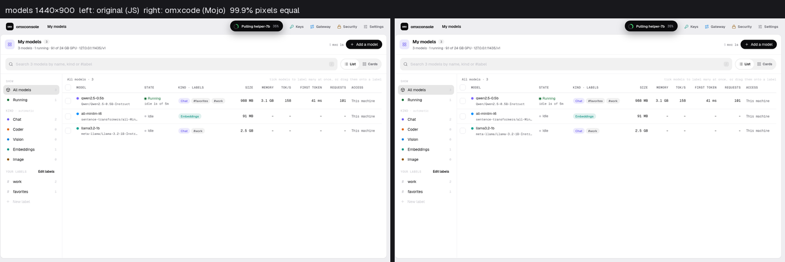
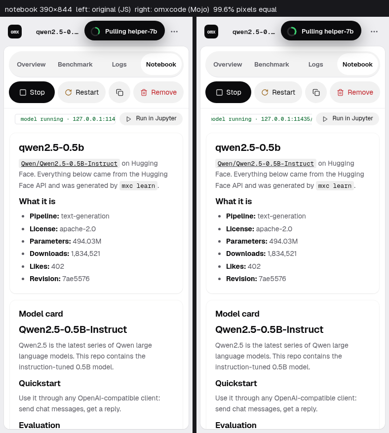

# Goal 33 report: OMX Console, rebuilt in omxcode

**End goal (owner, 2026-10-25):** "the whole point of the framework is to build apps and it should have all the
components necessary… it proves it can build a console app like this… the web should be identical, 99 %… showcase it
in our gallery." Then: "Don't overfit the app. The framework components should be developed if not present; the app is
a showcase with no special logic."

## Result
M0–M8 PASS (M0–M7 again in the final run on the merged sources, with a fresh Mac run 40501608105; M8 passed before
the reviewer's fixes were merged, in 5,457 s against Mac run 40426854872; the owner stopped its rerun to move on, and
the full chain runs at the next stable point). Reviewer: round 1 NEEDS WORK (an HTTP header-injection hole; the
console's routes inside the framework), round 2 PASS.

- **Web:** all 20 shots (10 screens × desktop 1440×900 and phone 390×844) have ≥ 99 % of pixels equal to the
  original JavaScript console fed the same recorded daemon replies (lowest 99.2 %; M0's own noise floor 0.000 %).
- **Linux (GTK) and the Mac (AppKit):** native widgets, 0 of 1,425 and 0 of 1,268 tagged views more than 4 pt or 3 %
  from the web's. **Note (D-551, kept by the owner, D-578):** on GTK and the Mac the test window grows to the whole
  page (716 and 710 px) while the web's is 640 and scrolls; M7 compares pages, not windows. A real window scrolls as on
  the web.
- **Live:** a real mxconsole daemon (fake `max`) driven through the GTK console: load a model, its numbers update,
  create a key, `/v1` answers 200, revoke it, `/v1` answers 401, stop the model.

| Original (JS) vs omxcode (Mojo) | |
|---|---|
|  |  |

## What the framework gained (31 modules, each with a test)
HTTP as effects with a swappable transport (sockets now, flare later), timers, decimal JSON; the omxqua theme as a
Look; Table, Paragraph (host-wrapped rich text), Markdown, Document, CodeBlock, LogView, Timeline, Sparkline, Meter,
Shell, Header, Sidebar, Breadcrumbs, a generic Router, Chip/Marks, Confirm, Copy, Fields, Results, Panel, Feedback,
Skeleton, Beacon, DragDrop, Embed; layout features any app gets (block flow, a spacing scale, line heights, one-line
text, dense tables, browser line-breaking on GTK and the Mac). The console app only composes them: a lint fails it if
it sets a colour, font, size or imports a host.

## Decisions worth a second look
1. **D-551/D-578:** M7 compares pages, not windows, on GTK and the Mac (owner kept it).
2. **D-560:** three archived checks (goals 5, 6, 27) read code later goals changed on purpose; goal 5's is stricter,
   goal 27's exempts two screens until their goldens are re-taken (D-579, owner approved, queued).
3. **D-310/D-320:** our own HTTP/1.1 client now, flare (ehsanmok/flare) behind the same seam with Mojo 1.2; flare's
   HTTPS bug is filed upstream (flare#42).

## Left for the next stable point
The full regression chain (goal 32 → 30 → 3); D-579's golden re-take and GTK toolbar icons to 32 pt; the reviewer's
round-2 should-fixes (goal 6's timer check by behaviour, a test for control characters in an env header's value).

## Next
Goal 34: first-class JS (docs/goals/34-draft.md).
