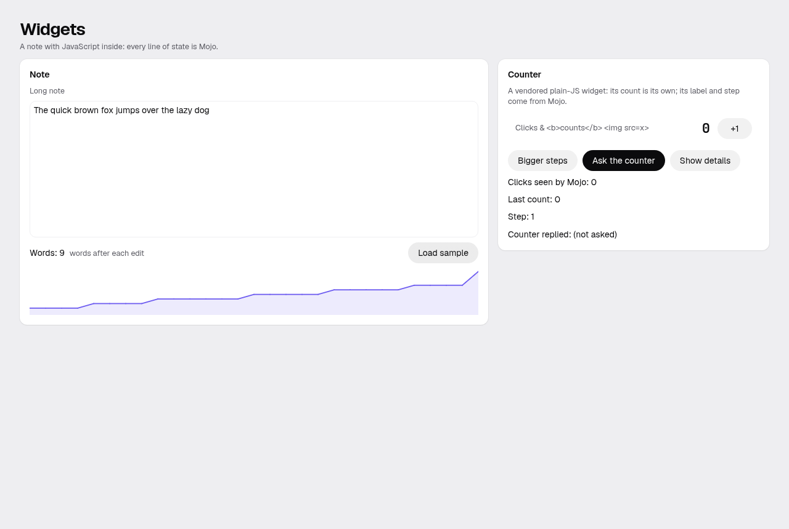
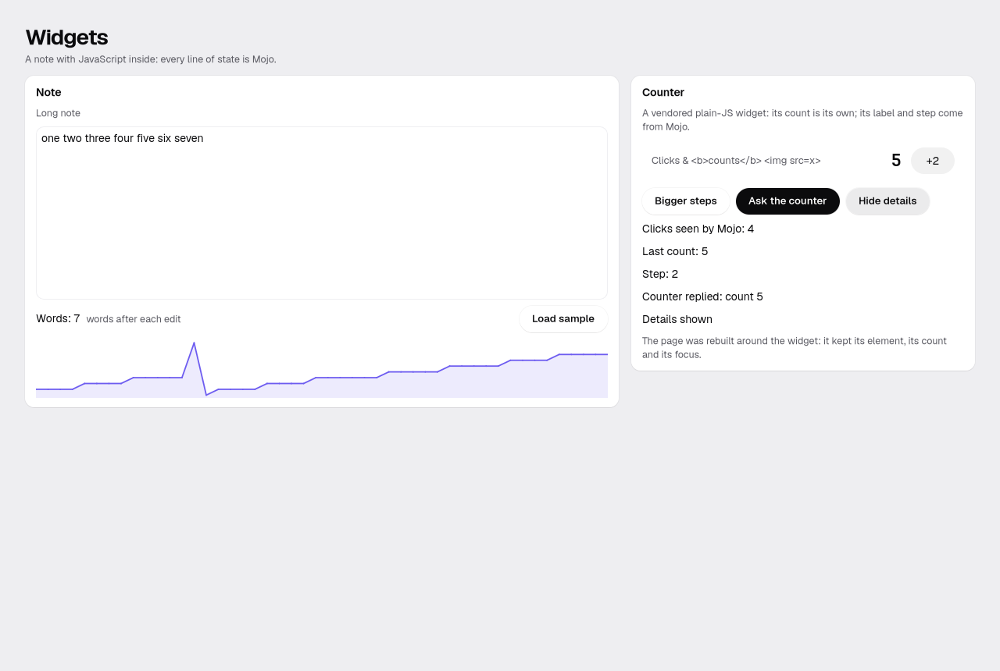

# Goal 34 report: first-class JS

**End goal (owner, 2026-10-25/27):** "we need first-class JS support or else web dev will be stalled… iframe is not
secure… manage minification of JS and the security part." This cut covers the web and Linux (D-590); the Mac's
WKWebView, agent visibility and a second library are 34b.

## Result
M0–M4 PASS (M4: goal 33's M1, M2, M4, M5; the full chain waits for the next stable point, owner). Reviewer: round 1
NEEDS WORK (a same-origin check by string compare; the Linux launcher and build failing without bubblewrap or WebKit),
round 2 NEEDS WORK (Python's and the browser's URL parsers disagree), round 3 NEEDS WORK (hex last labels read as
IPv4), round 4 PASS.

| The widgets app on the web | The same app on Linux (GTK + WebKitGTK) |
|---|---|
|  |  |

## What a developer gets
- **`WebComponent(tag, props, on_event)`** in Mojo and **`mojoui.defineWidget({mount, update, commands})`** in JS:
  props go down as JSON, events come back into `update()`, Mojo calls a widget's commands and gets replies. A widget
  keeps its own state, cursor and focus across rebuilds.
- **npm and TypeScript:** `web/package.json` + lockfile per app; `npm ci --ignore-scripts` and esbuild at build time;
  CodeMirror 6 from npm, written in TypeScript, is the proof. `scripts/new_widget.sh` makes a widget; `docs/js.md`.
- **Secure by default:** a strict CSP (scripts only our own hashed files: no inline script, no eval; inline styles
  allowed, with the reason in docs/js.md); every asset by content hash with SRI; JSON-only data in both directions; a
  build lint against stray assets; WebFrame sandboxed with no permissions unless asked, http(s) only, and
  `allow-same-origin` only for a plainly foreign origin.
- **Linux:** each widget runs in its own WebKitGTK view with the same bundle and CSP; no network, no navigation, no
  file access beyond the bundle; a crashed view reloads once, then shows the widget's stand-in.

## Decisions worth a second look
1. **D-610–D-612, D-617–D-626:** WebKitGTK comes from the system when installed (`sudo pacman -S webkitgtk-6.0`),
   else from Arch's package (pinned SHA-256) laid over /usr/lib by a bubblewrap launcher that falls back to running
   the app directly.
2. **D-624, D-627:** plain dotted IPv4 hosts may still get `allow-same-origin` (the console's Jupyter on another
   port); every other spelling is refused.
3. **D-593 onward:** `style-src 'unsafe-inline'` stays (layout is style attributes; CSS can't run script).

## Next
34b (the Mac's WKWebView, agent visibility, a second library); then the particle showcase (docs/goals/showcase-draft.md).
