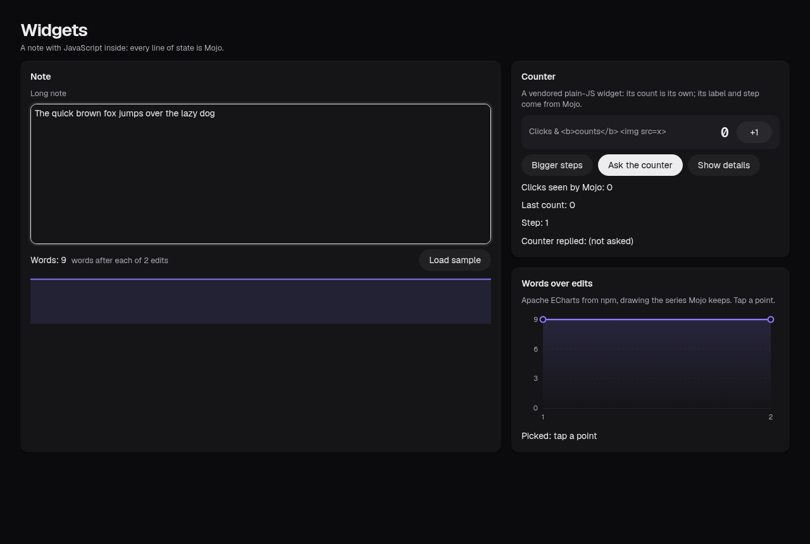
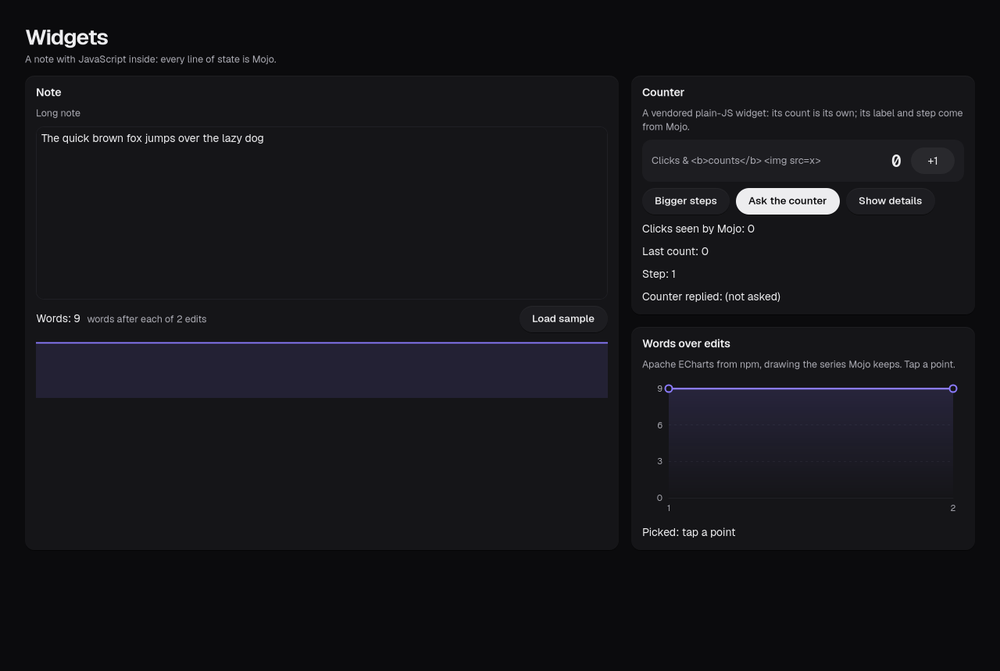
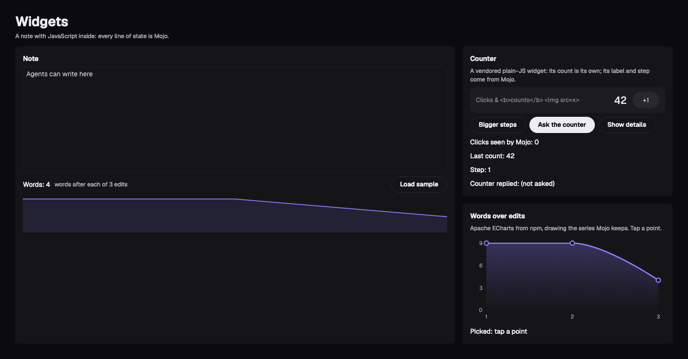

# Goal 34b report: JS widgets everywhere, and agents see them

**End goal (owner, 2026-10-27):** "continue as 34b… first-class integration means first-class support to JS; AG-UI
comes later."

## Result
M0, M1, M1b, M1c, M2, M3 PASS (Mac run 40617272485). Reviewer round 1: PASS (no must-fix; should-fixes follow).

| Web (dark) | Linux, GTK (dark) | Mac, AppKit (dark) |
|---|---|---|
|  |  |  |

- **Agents see JS widgets:** a widget describes itself (`describe()`) and declares settable fields; the agent host
  lists it as tools (`editor-read`, `editor-set {text}`, `counter-set {count}`, `chart-read`); undeclared fields and
  wrong types are refused by the agent host, the runtime and the page.
- **A second library with no host changes:** Apache ECharts from npm (M1's host check is a receipt of the ECharts
  change set a87c7cc..760bb66, pinned by SHA: it touched no host file. It is not a regression guard: later host
  changes don't fail it).
- **First-class citizens:** widgets wear the theme (tokens as CSS variables and `theme()`), switch light/dark live;
  Tab order crosses native controls and widgets; CodeMirror and ECharts live in `mojoui/widgets/` for any app.
- **The developer loop:** `scripts/dev.sh <app>`: save, rebuild, reload with the Mojo state kept; JS errors with their
  real file and line; WebKit's inspector in debug builds (GTK runs it; the Mac's debug build, `MOJOUI_DEBUG=1 scripts/build.sh <app> mac`, compiles with it but hasn't run on a Mac).
- **The Mac:** each widget in its own WKWebView, the same bundle, CSP, JSON-only messages and checks as GTK.

## Known gaps
An outside agent can't attach to the Mac app yet (needs socket stubs in apple/sdk); the reviewer's should-fixes are done (D-677–D-682, check M0 M1c M1b M3 PASS on 2026-10-27): the agent link decodes whole
lines, the socket's mode and the dev server's bind, token and debug-only start are tested, jslog is limited on GTK and
the Mac, and a crashed page's commands get an error reply.
