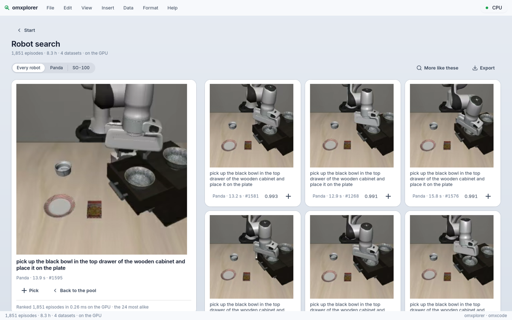
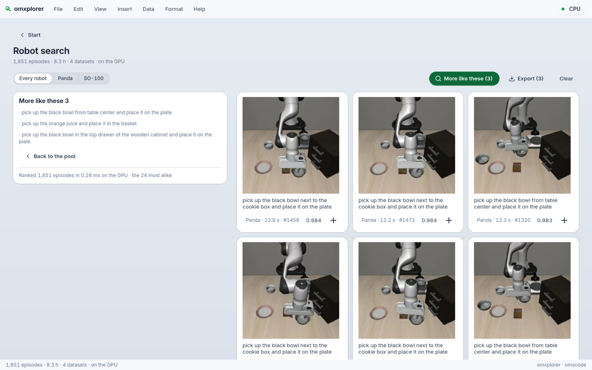
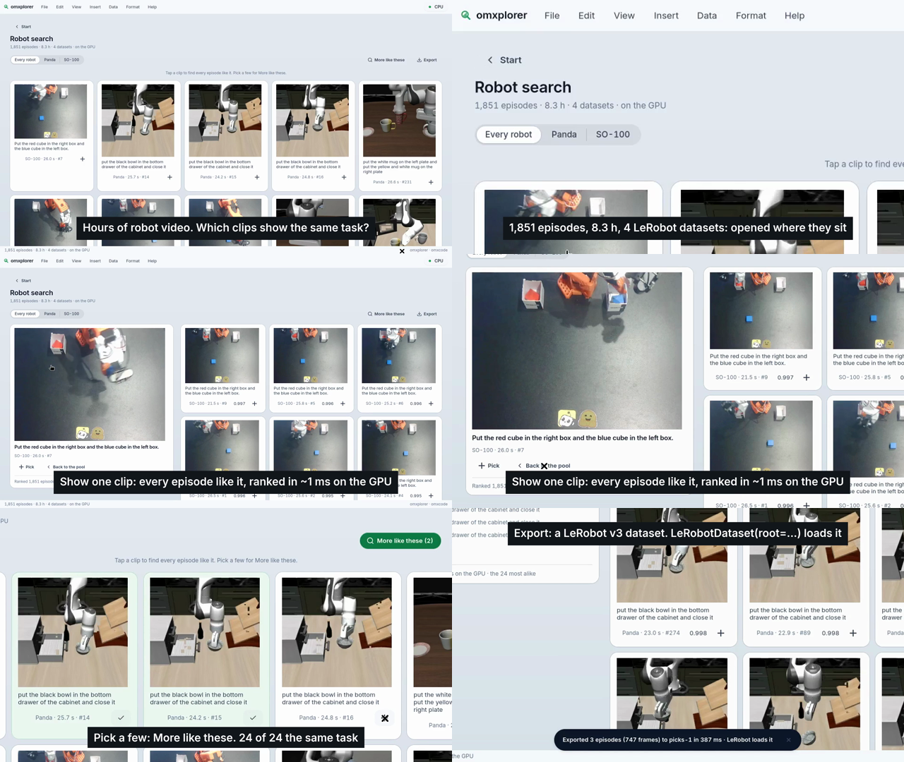

# Goal 71 report: robot search by example in omxplorer, on omxcore stable 5194d77

**End goal (issue omxcode#9, owner 2026-11-14):** vendor omxcore's new stable engine, which adds robot data, and open the
show in omxplorer with the robot search demo. The deck comes next, built on this app.

**Got to:** M0–M5 PASS on the final code. The reviewer passed it in round 2, with no must-fixes; its should-fixes are done
or written down.

```
M0 PASS  5194d77 + the Mojo 1.2 patch rebuilds vendor/omxcore.mojoc; 9/9 omxcore examples build; 35/35 engine tests
         (test_robot_import: omxcore.robot beside Flare); the Mac apps' objects add no undefined symbol
M1 PASS  10 clips, 3 triples and one robot-filtered search: top 24 equal omxcore's Python; warm search 0.10 ms on the GPU;
         an export of 3 picks loads in LeRobot (3 episodes, 2,045 frames, tasks equal)
M2 PASS  frames equal omxcore's decode (0/255 off); 24 posters 537 ms cold (NVDEC), 0.01 ms cached; ClipGrid on GTK and the web
M3 PASS  test_robotsearch; real clicks on GTK: tap a clip, the screen's 24 equal M1's; pick 3, More like these, equal M1's;
         Export, the toast, LeRobot loads it; desktop 1440x900 and phone 390x844 (web): nothing clipped
M4 PASS  cold-open.md's 4 numbers each in omxcore's report; cold-open.mp4 34.0 s 1920x1080; 5 scenes; the take shows 24 of 24
M5 PASS  goal 68's checker M0–M6 (with goals 47, 59, 62), the component matrix, decisions, libc and seek lints
```

## 30-second demo

```sh
cd ../mojo-ui-g71
scripts/build.sh omxplorer linux
OMX_ROBOT_POOL=~/Projects/mxframe/build/robotics/index.parquet build/omxplorer/linux/omxplorer
```

Or open omxplorer and pick **Robot search…** on Start, then choose a moments index (a `.parquet`). Tap a poster to get the
episodes like it. Pick a few, then press More like these. Export writes the picks to `~/omxplorer-exports/picks-N`.

| | |
| --- | --- |
|  |  |
|  |  |

The film is `build/g71/cold-open.mp4`. The shot list is `docs/goals/71/cold-open.md`; make it again with
`docs/goals/71/cold_open.py`.

## What was built (framework first)

- `mojoui/robotpool.mojo`: the pool over omxcore's moments index. It covers each episode's facts, search by example
  (one clip, several, or one robot), export to LeRobot v3, and clips decoded by the engine and scaled for cards.
- `mojoui/clipgrid.mojo`: a grid of clips you tap, compare and pick. It uses a new `Image(on_tap=)` on GTK and the web.
- `mojoui/robotsearch.mojo`: the page any app can host. Open, decode and export run as background jobs. The engine
  work is Linux-only, behind `comptime if`.
- `mojoui/hfcache.mojo`: opens a dataset where the Hugging Face cache keeps it.
- omxplorer: a Robot search screen, reached from Start, or straight in with `OMX_ROBOT_POOL`.

## Three decisions worth a second look

1. **D-7108:** Robot search is built for Linux only. On the Mac, decoding needs Mojo's async runtime (MAX's device
   context) and libc calls the app's Mac link doesn't carry. The Mac page says so. Moving the work behind the Mac's own
   decoder is the follow-up.
2. **D-7107:** the phone is checked on the web host, not GTK. A GTK window can't be narrower than omxplorer's menu bar
   (581 points). On a phone, the robot screen drops the menu bar and status bar.
3. **D-7101 and D-7102:** the engine runs in-process (`omxcore.robot`), and "equal" means equal to omxcore's own Python
   in its `robotics` env.

## Known gaps

- The film's pointer shows X's bare "x" over plain buttons; it needs a cursor pass before it goes in the deck
  (cold-open.md).
- Asks for omxcore, as `mxframe` issues to open:
  - resolve a Hugging Face repo id in the Mojo package (only `mx` does today);
  - `Frame` over a table with a VECTOR column (F-224 refuses it);
  - libc calls looked up at run time upstream, so apps don't carry the Mojo 1.2 patch.

**Next:** the owner's launch, which is polish rather than features (the launch kit Claude Doc). The deck goes on top of
this app.
