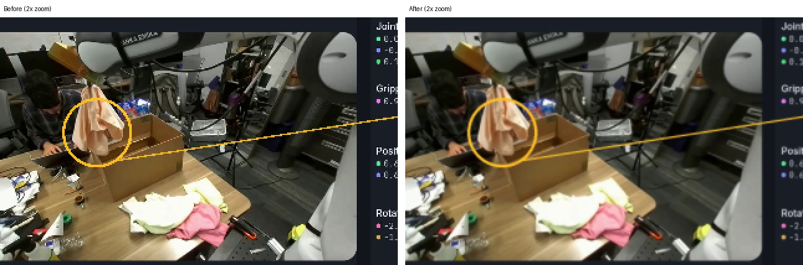

# Goal 81 report: what the GPUI study found in our app layer, fixed (2026-11-24)

The owner's ask: the GPUI study's "real quality" and "moderate" rows, nothing else. Branch `goal-81-quality`, on top of bench-nanoui 2571778d.
Checker: `scripts/check` (docs/goals/81-check.py). Decisions D-8101–D-8110. Reviews: first NEEDS WORK (2 musts, 6 shoulds: fixed), second PASS on the fixes (5 small shoulds: fixed, not reviewed a third time).

| # | What | Result |
|---|---|---|
| M1 | Patched screen = fresh screen, at random | PASS: 6,300 random pairs, 0 wrong, 10,396 planted faults all caught; 900 screens through real GTK (2,400 in a longer run), 0 wrong |
| M2 | Long lists | PASS: 600 rows + 1 on top: 1 of 1,804 widgets kept → all of them (10,000 too); 499 unchanged rows 1.74 → 0.08 ms; cost grows with length, not its square |
| M3 | Several long lists | PASS: 0 stale rows of 280 (old way: 13 stale reads) |
| M4 | No lost input (GTK) | PASS: 0 of 1,215 (0 of 4,175 in a longer run); the base lost 890 of 1,240 in the same kind of burst, which is harsher than a person's input |
| M5 | Hang monitor | PASS on Linux: says what hangs while it hangs and after; 0.17 µs an event; 0 wake-ups idle. On the M4 too (11-25): the same two lines for a 1.2 s update |
| M6 | Mac: a new letter | PASS on the M4: at most 112 rows a frame sent, of up to 2,036 in use; 180 frames, 0 levels from the reference |
| M7 | Mac frame clock | PASS on the M4 (11-25, unlocked): 144.2 ticks a second on its 144 Hz screen (the timer gave 60), 0 while hidden or idle, 60 from the fallback when the screen's clock doesn't tick |
| M8 | Pictures | PASS on GL, Metal, CPU: worst 0.88 levels from a perfect box filter (bar 2); unscaled bit for bit; an unchanged 1920 × 1080 picture costs 0.0 ms a frame (2.0 ms when copied and hashed) |
| M9 | Nothing slower or broken | PASS: goal 80's held-out scenes worst 1.009× (bar 1.05; bests 0.90×); 30 tests; 6 Linux apps built and opened headless, 3 AppKit apps built and run unshown on the M4 |

## What the random tests found that nobody knew
Beyond the study's faults, comparing thousands of patched GTK screens with fresh ones found eight more, all fixed: an icon
that changes kept its old picture; a canvas's new tooltip went to the wrong widget; a changed width cap reset a control's own
size; a picture becoming tappable (or not) kept its old state; a grid's new items came last for a screen reader; an item
moving into or out of a fitted grid's last column kept the wrong layout; a row whose children all grow didn't share
equally after a change; a board's card highlight didn't follow its card. And a serious one by design: the host's own write
into a text field could come back later as if typed, overwriting the app's newer text.

## Worth a second look
1. D-8108: the GTK rebuild now runs before the next input and frame (G_PRIORITY_HIGH).
2. D-8103: the CPU reference test draws pictures nearest, because scaled ones are filtered on purpose now.
3. D-8105: pictures are smooth by default; a heat map's cells need `smooth=False`.

## Not done, not checked
- **Fixed 2026-11-25 (goal 79's finding):** the display link and the hang monitor's run-loop observer were added with a string that
  reads `kCFRunLoopCommonModes`; Core Foundation knows the mode by address, so neither ever fired. Both now use the constant
  itself (`common_modes()`), and both were then measured on the unlocked M4. Running that also showed two faults of the clock
  itself, fixed: frames could stay stopped after the window came back (macOS's notice can come before it counts as visible: it
  is now looked at every half second while hidden), and the fallback retried the dead clock at every restart (now: the timer
  until the window is seen anew). These fixes were run, not reviewed.
- Keeping widgets across shape changes on Mac, iPhone, Android, web (F5), F7, F8: not chosen. Text spacing, contrast, snapped borders: skipped by the owner.
- Dropped input was a GTK fault; the web and Apple hosts weren't tested for it.
- A changing picture drawn with `image()` (a video frame) costs about as much CPU as before plus 0.7 ms for its half size at 1080p when drawn smaller.
- The Mac cross-link from Linux fails as it did at 2571778d (16 symbols; D-8110): goal 81 adds none.
- 22 older tests can't run here (missing data, codecs, Flare) and fail the same way at 2571778d.
- iPhone and Android weren't built.
- Merging: conflicts with goal 79 (its scene.mojo `_copy_ops`, gtk.mojo, appkit.mojo, gpu2d*.mojo). Re-test after.
