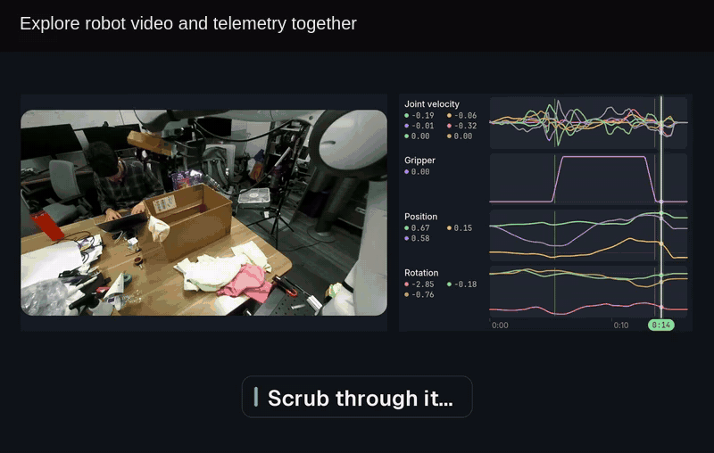

# omxcode: native apps, GPU work and agent tools—in Mojo

I’ve been building **omxcode**: a Mojo framework where the native interface, GPU work and agent tools come from the same app. Here’s a quick look at robot data, agent-built screens and a desktop console around MAX.

[See it and download an app](https://abhisheksreesaila.github.io/omxcode/) · [Setup in the README](https://github.com/abhisheksreesaila/omxcode#download-and-run)

It’s a public alpha. Try it on your machine and tell me what works, what’s missing, or what you’d build with it. [Feedback and contributions welcome.](https://github.com/abhisheksreesaila/omxcode/issues)
