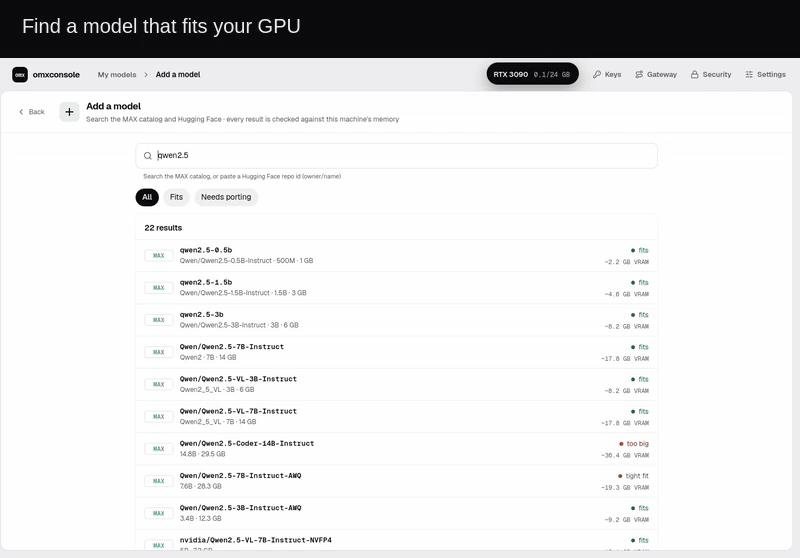

# omxconsole: local AI on MAX, made easy

I built **omxconsole**, a native desktop app around MAX: find a model, download it, serve it and run a benchmark from one place. The app and its companion service are written in Mojo, using **omxcode**; MAX runs the models.

[Download the alpha](https://abhisheksreesaila.github.io/omxcode/omxconsole.html) · [Setup and platform notes](https://github.com/abhisheksreesaila/omxcode#readme)

MAX users: I’d love to hear how it runs on your machine and what you’d want next. [Feedback and contributions welcome.](https://github.com/abhisheksreesaila/omxcode/issues)
