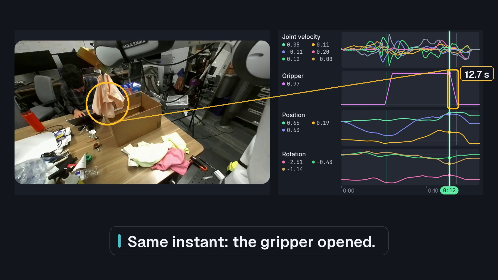

# Agent tools



*This clip was recorded while omxplorer was driven by its agent tools alone.*

- The agent host turns the screen into MCP tools. A control's tag names the tool and its tooltip describes it.
- The tool list follows the screen: an agent can do only what a person could do right now.
- An agent can read every text on screen, read the grid's rows, and see any canvas as a picture.

The whole robot story (fleet, links, questions, paper, packs) was played through agent tools, with no frame over the
50 ms budget. In the models goal, the agent labelled 20 stops and ran Learn over MCP.

## How to try it

```sh
scripts/build.sh omxplorer web
scripts/agent.sh omxplorer          # prints the one `claude mcp add …` command
pixi run python scripts/agent_client.py build/omxplorer/web screen
pixi run python scripts/agent_client.py build/omxplorer/web open-the-sample
```

Then, in Claude Code: "open the sample in omxplorer, sort by revenue largest first, and tell me the top order".

## Not there yet

- The yes that lets a model's code run has no agent tool, on purpose: only a person can give it.
- An app must build for the web to be driven by an agent.
- At goal 19: an agent could not drag board objects, and untagged duplicate buttons got names like `open-2`.

<sub>Source: docs/goals/19-report.md; docs/goals/47-report.md (M8, the clip); docs/goals/68-report.md (M1, M2).</sub>
