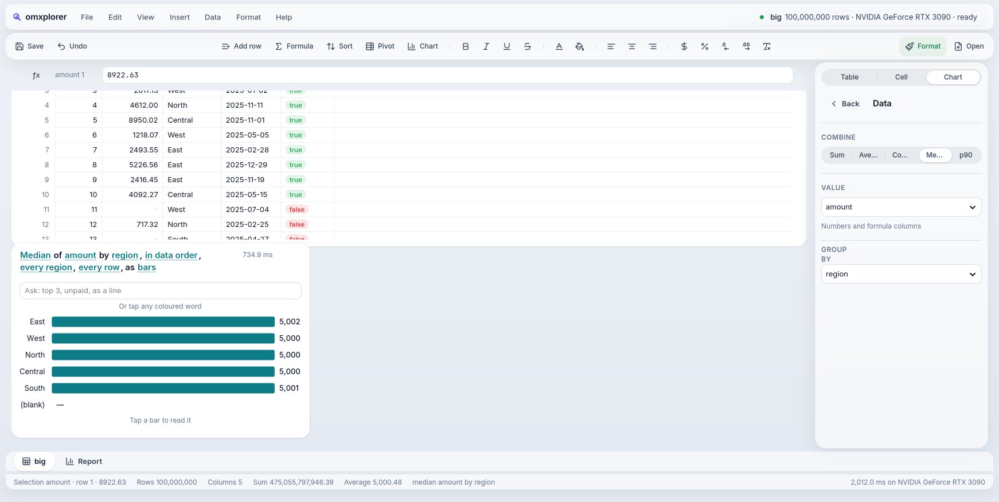

# Any table



*A median by region over 100 million rows. The island at the top shows the work while the window stays live.*

- Open a CSV or Parquet file as a sheet: sort it, edit it, add formula columns, chart it and pivot it.
- Big queries run as background jobs. The island shows progress, and the window keeps drawing.
- A file bigger than memory opens streamed and stays editable; Save streams the edited file back out.

At 100 million rows: opening a Parquet file into memory took 1.8 s, a median of amount by region 0.77 s, and the longest
pause between frames while it ran was 33 ms. Streamed, 100 million rows opened in 0.2 s, a total took 210 ms and a
group-by 553 ms. Saving 100 million edited rows took 6 s with memory peaking at 0.27 GB.

## How to try it

```sh
scripts/omxplorer.sh path/to/big.csv     # or a .parquet
```

Create table, then Insert → Chart, and ask *median* or *by month, as a line*. Type while it runs: the cursor keeps
blinking. Tap the island for Recent and Device.

## Not there yet

- The Mac runs jobs one at a time inside the call, so its window waits on big queries.
- On a streamed file, sort, median and distinct are refused when their working memory would not fit a quarter of the
  machine's. The app says why.

<sub>Source: docs/goals/30-report.md ("What it costs", "Not done"); docs/goals/22-report.md (M1, M2, D-215).</sub>
