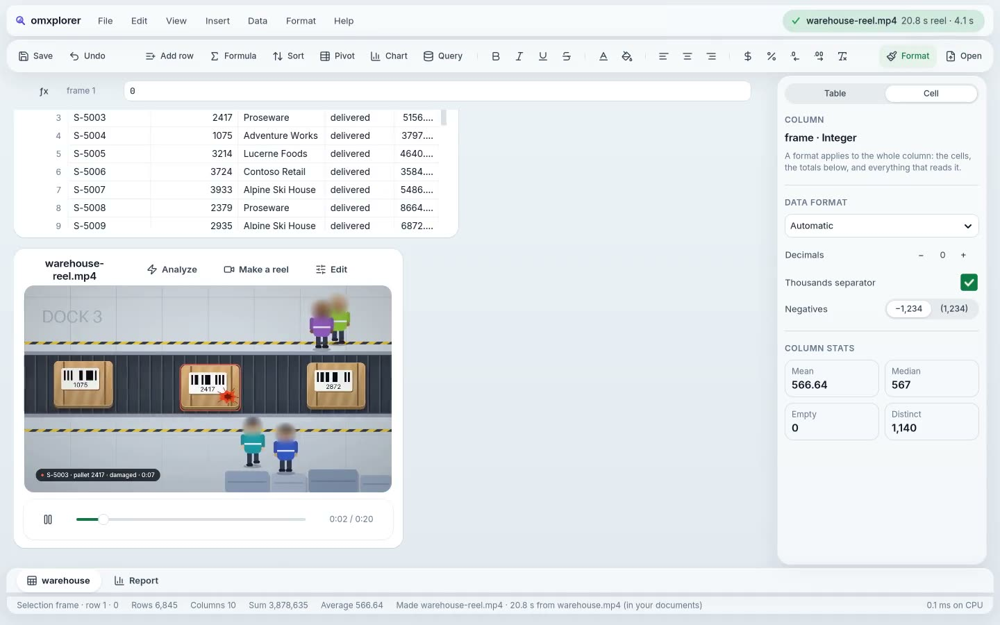

# Blur faces



*A reel made from warehouse footage, with every face blurred.*

- The video analysis finds faces, and Make a reel blurs them in the cut.
- Blur, crop and text run on the GPU, and the checks compare the GPU result with the CPU's.
- Making the reel runs as a background job.

A blur on a 720p frame took 0.53 ms. The warehouse reel blurred 30 faces.

## How to try it

```sh
pixi run python scripts/media_data.py build/g39/media    # generated footage and its truth
OMX_DOCUMENTS=build/g39/media scripts/omxplorer.sh
```

Open `warehouse.mp4`, then **Analyze**, then **Make a reel**.

## Not there yet

- Tried on generated footage only, not real-world footage.
- Video and analysis cards are not saved in `.omx` files.

<sub>Source: docs/goals/39-report.md (M3, M5, "Not done").</sub>
