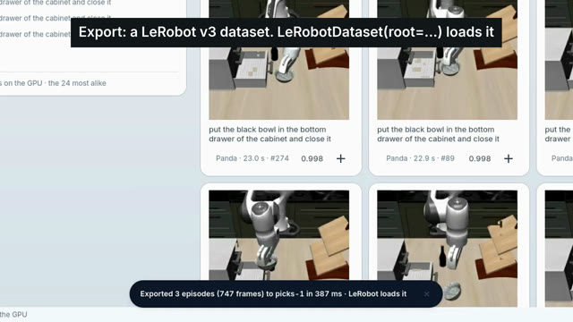

# Export to LeRobot

*Export on the Robot search page: the picks become a LeRobot v3 dataset.*

- Picks from [Robot search](Robot-search.md) are written as a LeRobot v3 dataset in `~/omxplorer-exports/picks-N`.
- LeRobot opens it with `LeRobotDataset(root=...)`.
- Export runs as a background job, so the window stays live.

In the checks, an export of 3 picks loaded in LeRobot as 3 episodes and 2,045 frames, with the tasks equal.

## How to try it

Open [Robot search](Robot-search.md), press **Pick** on a few clips, then press **Export**. The toast names the folder.

## Not there yet

- Linux only, like Robot search.
- Export starts from Robot search picks.

Source: docs/goals/71-report.md (M1, M3); docs/goals/71/cold-open.md (shot 5).
