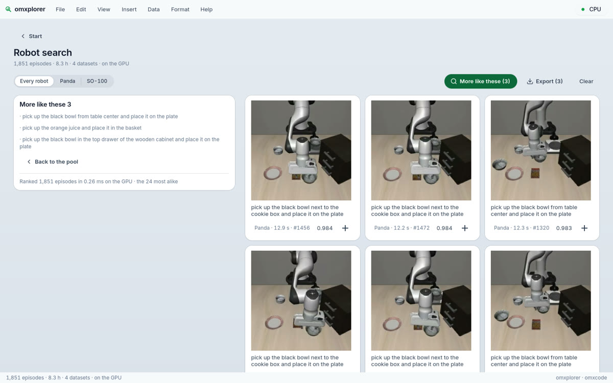

# GPU video decode

*The posters on the Robot search page are decoded on the GPU.*

- On the Robot search page, clips are decoded by the engine on the GPU (NVDEC) and scaled for the cards.
- Decoding runs as a background job, so the page stays live while posters arrive.
- Decoded posters are cached for the next time they are shown.

24 posters took 537 ms cold and 0.01 ms cached. The frames equal omxcore's own decode, with 0 of 255 levels off.

## How to try it

Open [Robot search](Robot-search.md) on a Linux machine with an NVIDIA GPU. The posters on the pool and the results are the decoded
frames.

## Not there yet

- GPU decode is used by Robot search. Other video cards decode with ffmpeg on Linux and with AVFoundation on the Mac.
- Linux only. Moving Robot search onto the Mac's own decoder is the follow-up.

Source: docs/goals/71-report.md (M2, D-7108); docs/goals/58-report.md (M0, M1).
