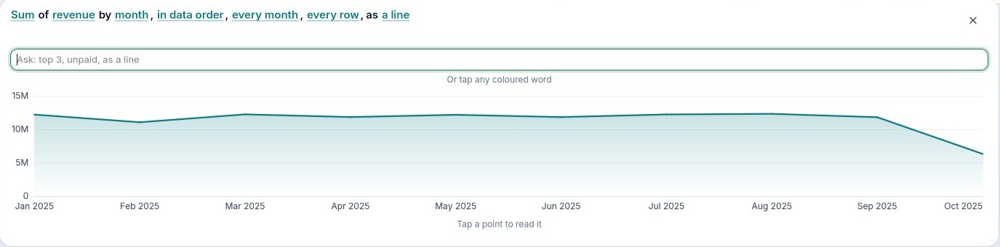

# Learn deck



*One of the deck's pictures: the chart sentence slide.*

- A reveal.js deck in `docs/learn/` that teaches omxcode from small to advanced, one idea per slide.
- It starts with two ideas (an app agents can use, and GPU code in the same language), then Start, Build and What's new.
- Every code block is cut from a real file in the repo, and every slide has speaker notes.

The deck has 32 slides. `scripts/tutorials.py` checks that 24 of 24 code blocks are their files' text.

## How to try it

```sh
pixi run python -m http.server -d docs 8000
```

Then open `http://localhost:8000/learn/`. A local server is needed because the diagrams load in frames.

## Not there yet

- The video links in `docs/learn/videos.js` are empty, so no slide shows a Watch button yet.
- This deck is about omxcode, the framework, rather than omxplorer's features.

<sub>Source: docs/decisions.md (D-4762, D-4763, D-4764); docs/journal.md (the learning deck); docs/learn/videos.js.</sub>
