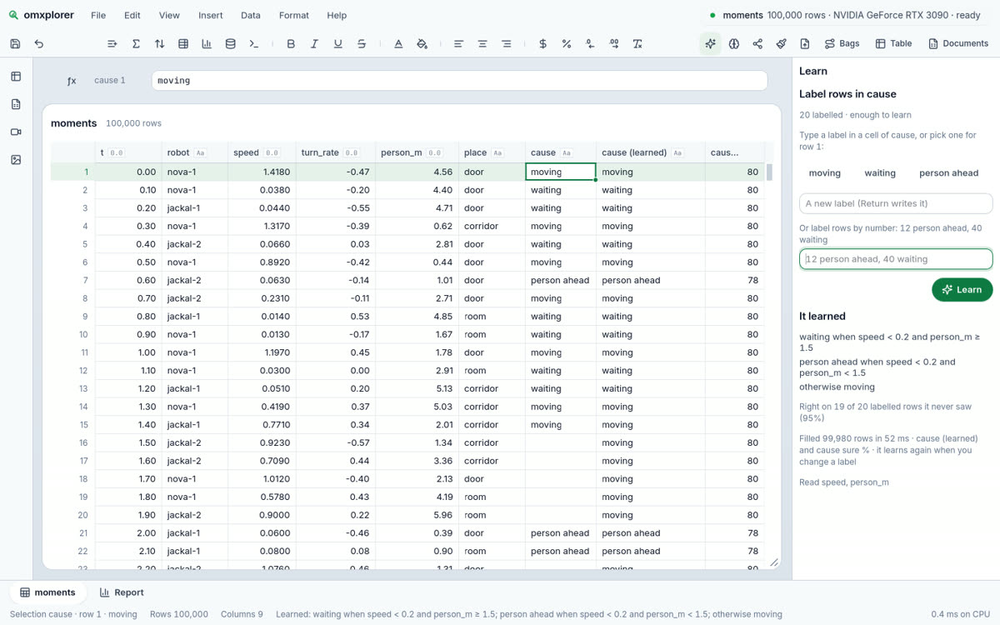

# Learn from labels

*Learn on a 100,000-row sheet: 20 labels in, a rule you can read out.*

- Type a label in a few cells of a column, then press **Learn**.
- omxplorer finds a short rule that explains your labels and fills the rest of the column with it.
- The rule is shown in words, so you can check it before you trust it. Change a label and it learns again.

In the checks, 20 labels on 100,000 rows gave "waiting when speed < 0.2 and person_m ≥ 1.5; person ahead when speed < 0.2 and person_m < 1.5; otherwise moving". It was right on 19 of 20 rows it never saw, filled the column in 52 ms, and relearned a changed label in 55 ms. On a robot fleet's bags, 20 labelled stops gave a rule that got 84 of 84 unlabelled stops right. An agent did the same over MCP with the `label-rows` and `learn` tools.

## How to try it

Open a table, pick a column to label (or add one), type a label in about 20 rows, then press **Learn** in the side panel. On the [[ROS 2 bags]] fleet, label the stops sheet the same way.

## Not there yet

- It learns small rules over the columns you have. It doesn't label video frames yet: labelling clips is on the roadmap.
- The rule is a decision tree, so it suits tables more than pictures.

Source: docs/goals/68-report.md (M1, M4).
