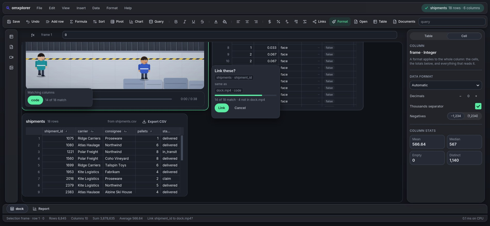

# Links

*Drag a column onto a card: omxplorer asks "Link these?" and shows how many values match.*

- Cards join only through links you confirm: a key (`a.id = b.id`), a time (`a.t ~ b.t +0`) or a place.
- Drag a table column onto a card, or type the link in the Links panel. The app shows how many values match.
- Once linked, a selected row follows to every linked card, and a query can use `JOIN LINKED`.

In the claims demo, `shipments.shipment_id` matched 14 of 18 values. A time link kept the cursor within one frame over
3 seeks.

## How to try it

In omxplorer, press **Links** in the toolbar and type a link, then press Return, for example
`fleet.episode = telemetry.episode`. Or drag a table card's column header onto another card and press **Link**. Hold a
card to peek: the rest dims and linked cards lift.

## Not there yet

- Only table-card headers start a link drag.
- The peek's label is not centred in its pill on GTK.
- Time links were not run on the web host.

Source: docs/goals/41-report.md (M6, M8, M9, "Not done"); docs/goals/47-report.md (beat 2).
