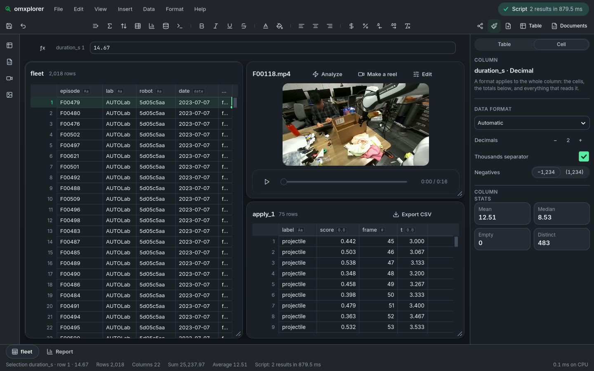

# Models as plugins



*Apply scene on part of a robot clip: the model's answers land as a table card beside the video.*

- A model comes in as a plugin: paste a Hugging Face id, or drop a file. Trees (XGBoost, LightGBM), ONNX, skops,
  PyTorch and compiled MAX packs are the kinds it knows.
- Models run in the app's own process and show up as functions, such as `classify`, `detect` and `scene`.
- Learn from labels: label a few rows and the app writes a short rule that explains them.

In the checks, four models of four kinds the app had not seen each answered under 3 s after their download. Tree models
matched their own libraries to 4.3e-7. A detector made 1,620 boxes in 6.7 s. Learn from 20 labels was right on 19 of
20 rows it never saw.

## How to try it

```sh
scripts/setup                       # env, build, demo data, the model env and packs
pixi run python scripts/scenario.py models --media build/g47/full --out build/g51   # agent tools only
```

Or by hand: in omxplorer press **Add a model** in the toolbar and paste a model id. A model's own code runs only after
you say yes.

## Not there yet

- No segmenters from the Hub yet.
- The packs path is Linux with NVIDIA. The Mac is untested; phones and the web can't load packs.
- `classify` agreed with the fleet's labels on 61.0% of rows, picked as the best of three models on the same rows, so
  that number is optimistic.
- The yes for a model's code is kept by repo and commit, not by the folder's content.

<sub>Source: docs/goals/68-report.md (M0–M2, stopwatch, "What's not done"); docs/goals/51-report.md; docs/goals/59-report.md.</sub>
