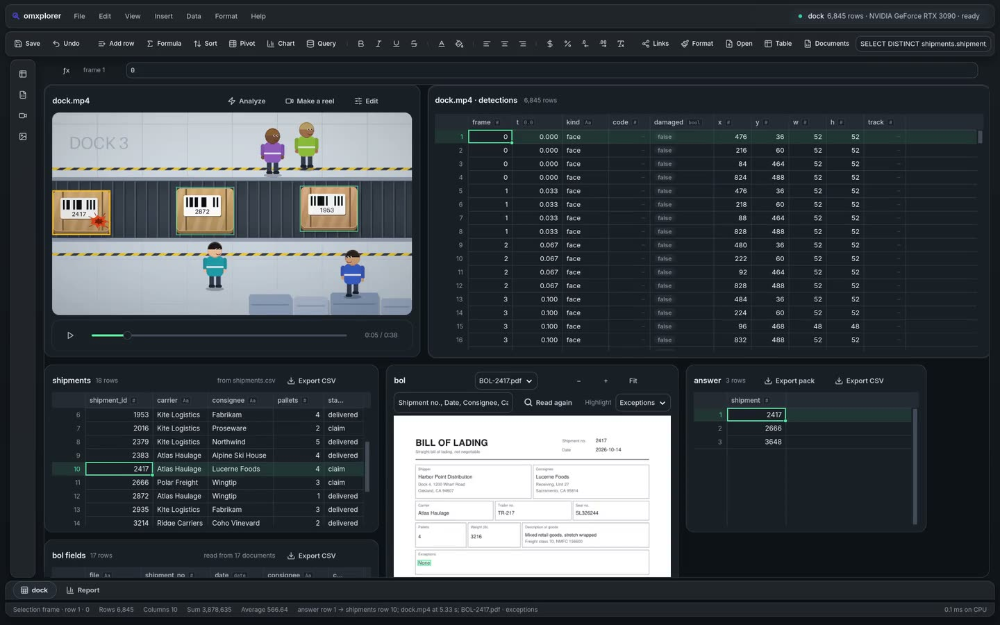

# PDF and OCR



*A document card beside the video and tables: a bill of lading with its exceptions field highlighted.*

- **Documents** opens a PDF, or a folder of them as one card.
- A Reader setting picks how text is read: an OCR model in the app's process, or the PDF's own text.
- Name the fields you want; they are read into a table and can be highlighted on the page.

In the claims demo, fields were exact on 119 of 119, and boxes matched on 117 of 119. Word recall on the FUNSD forms
was 0.81. The OCR model took 0.15 s a page and about 570 MB of GPU memory.

## How to try it

```sh
pixi run python scripts/claims_data.py build/g41/data
OMX_DOCUMENTS=build/g41/data scripts/omxplorer.sh
```

Press **Documents**, choose the folder, pick a Reader, type the fields (for example `Shipment no., Date, Consignee`)
and press Read again.

## Not there yet

- Tried on generated documents and digital PDFs only: no scans or handwriting.
- The web host can't pick a folder, so documents by folder are GTK only.

<sub>Source: docs/goals/41-report.md (M7, "What the framework gained", "Not done"); docs/goals/47-report.md (beat 4).</sub>
