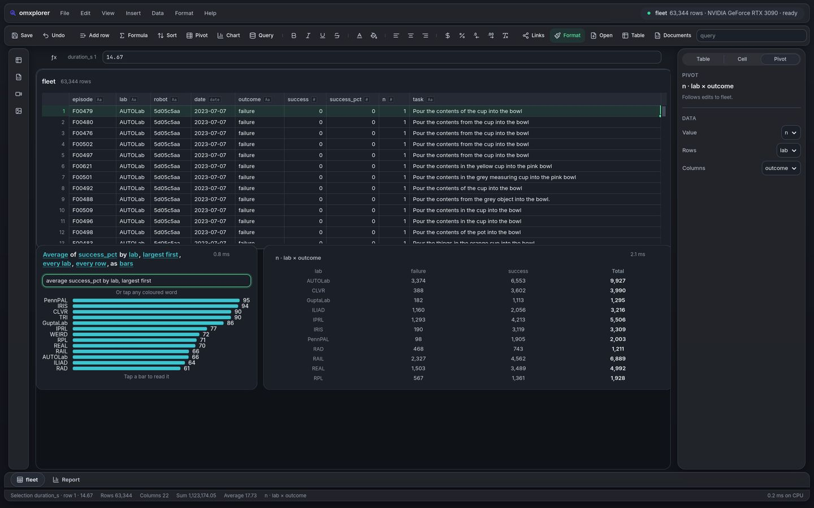

# Pivots

*A pivot of DROID episodes by lab and outcome, beside the fleet table.*

- **Pivot** in the toolbar places a pivot on the sheet: pick a value, rows and columns.
- It shows row, column and grand totals, in the value column's format.
- Sums run on the GPU; the checks compare them with a CPU pass.

In the robot story, the pivot of failures, successes and totals for all 13 labs equals the fleet file. Charts and pivots
over the fleet took 1.7 to 19.7 ms.

## How to try it

With a table open, press **Pivot** in the toolbar, then set Value `n`, Rows `lab`, Columns `outcome` (the robot story,
see [Video and telemetry](Video-and-telemetry.md)).

## Not there yet

- The reports name no open gap that is only about pivots. The Report page has one filter for now.

Source: docs/goals/15-report.md (M1, M3, D-148); docs/goals/47-report.md (M3, beat 1); docs/goals/70-report.md (M1 table).
