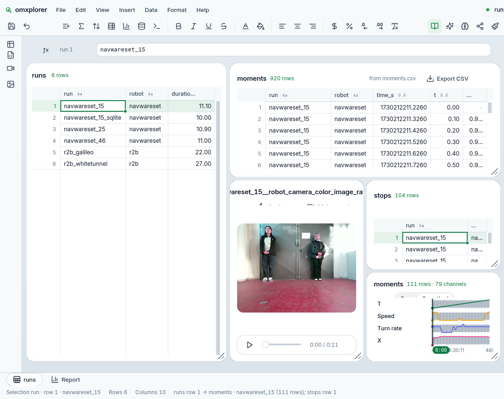

# ROS 2 bags



*A folder of ROS 2 bags opened as a fleet: runs, moments, stops, a camera as video and its channels as lanes (web host).*

- It reads ROS 2 bags in Mojo: MCAP (zstd, lz4 and stored chunks) and the older rosbag2 sqlite3 format.
- A folder of bags opens as a fleet: one row per run, every topic joined on time into moments, and the stops.
- Cameras (H.264 and JPEG) become videos that play on the same cursor as the data.

In the checks: 6 public bags (1.42 GB) gave 31,727 messages and 919,328 fields equal to the official readers, with 0
differences. Every topic of all six read in 2.1 s. The fleet was 920 moments by 83 columns, with 104 stop rows, read in
1.9 s. 19 cameras became videos in 14.2 s.

## How to try it

```sh
pixi run -e bagcheck python -I scripts/fetch_bags.py build/bags   # public r2b and NavWareSet bags, CC BY 4.0
scripts/build.sh omxplorer linux
build/omxplorer/linux/omxplorer
```

On Start, pick **Open robot bags…** (or **Bags** in the toolbar) and choose the folder of bags. Label a few stops, then
press Learn from labels to get a rule that explains them.

## Not there yet

- On GTK, the camera card is clipped when the fleet tiles five cards. The web host shows it whole.
- Not read: protobuf channels, XCDR2, wstring. TF, point clouds and camera calibration are not joined into moments.
- A run's robot name comes from its folder name, since bags don't say.
- Mac and iPhone were not built for this feature.

<sub>Source: docs/goals/68-report.md (M3, M4, "What's not done").</sub>
