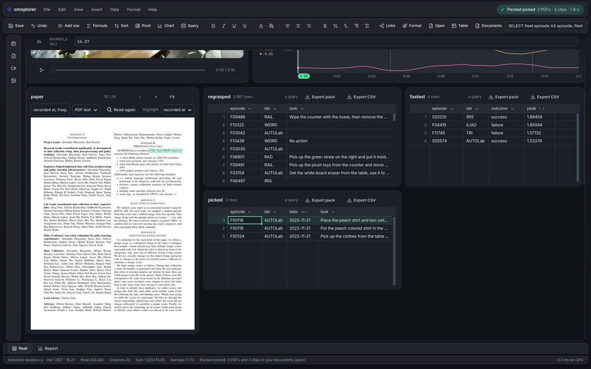

# Reels

*Export pack on a query card: a PDF and a short clip per picked episode.*

- **Make a reel** on a video card cuts a new video from it, with its edits (blurs, text).
- **Edit** opens a timeline: split, trim, delete and undo, with data lanes under the video and export.
- **Export pack** on an answer card writes, per row, a PDF of its facts and a short clip.

The warehouse reel came out at 20.77 s against a target of 20.80 s. In the robot story, a pack per picked failure held a
PDF and a 6 s clip. On the web copy, one pack of 3 PDFs and 3 clips was 4.7 MB.

## How to try it

On a video card press **Make a reel** (see [[Blur faces]] for the demo data). For a pack, run a query that returns rows
with a linked video, pick rows and press **Export pack**.

## Not there yet

- No audio.
- The timeline editor has no spring motion yet.
- On the Mac, the encoder ignores the quality settings and uses its own defaults.

Source: docs/goals/39-report.md (M5, M11, "Not done"); docs/goals/47-report.md (beat 5); docs/goals/62-report.md (M3); docs/goals/58-report.md.
