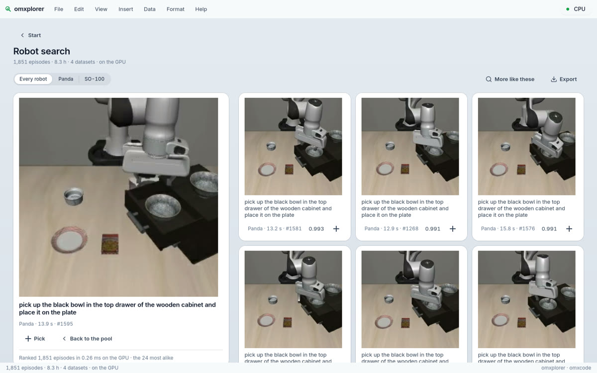

# Robot search



*Robot search on Linux: a tapped clip on the left, the episodes most like it on the right.*

- It opens a pool of robot episodes from an omxcore moments index (a `.parquet` file), where the datasets already sit.
- Tap one clip to rank every episode like it. Pick a few and press More like these, or filter by one robot.
- Export writes your picks as a LeRobot dataset (see [[Export to LeRobot]]).

In the checks, the top 24 results equal omxcore's own Python, and a warm search took 0.10 ms on the GPU. The pool in
the demo film holds 1,851 episodes, 8.3 hours, from 4 LeRobot datasets.

## How to try it

```sh
scripts/build.sh omxplorer linux
OMX_ROBOT_POOL=~/Projects/mxframe/build/robotics/index.parquet build/omxplorer/linux/omxplorer
```

Or open omxplorer, pick **Robot search…** on Start, and choose a moments index (a `.parquet`). Tap a poster to get the
episodes like it. Pick a few, then press **More like these**. **Export** writes the picks to
`~/omxplorer-exports/picks-N`.

## Not there yet

- Linux only. On the Mac, decoding needs pieces the Mac build doesn't carry yet; the Mac page says so.
- The phone layout was checked on the web host, not on GTK.
- Opening a Hugging Face repo id from the Mojo package, and a table with a vector column, wait on omxcore.
- Typing a phrase to search is left out; it is a rough first cut upstream.
- The demo film needs a cursor pass before it is used.

<sub>Source: docs/goals/71-report.md; docs/goals/71/cold-open.md (pool size, quoted from omxcore's robotics report).</sub>
