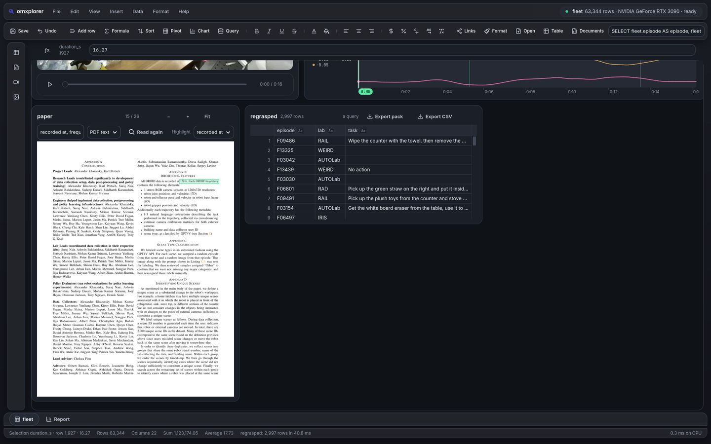

# SQL

*A question in words and its SQL, answered over the whole DROID telemetry table.*

- **Query** in the toolbar runs SQL across every table on the sheet. Each answer lands as a card of its own.
- A question keeps its words beside its SQL. `JOIN LINKED` joins tables on the links you confirmed (see [Links](Links.md)).
- Answers can be exported as CSV, or as a pack (see [Reels](Reels.md)).

"Failures where the gripper closed, let go and closed again" returned 2,997 episodes, a join over 16.8 million rows, in
37–42 ms in the check's runs. On the CPU-only web copy the same question took 108 ms.

## How to try it

Load the robot story (see [Video and telemetry](Video-and-telemetry.md)), then press **Query**, type the question in words, paste its SQL
(`ROBOT_SQL1` in `scripts/scenario.py`) and press **Run**.

## Not there yet

- The hosted web copy refuses `WITH`, `UNION ALL` and script statements, and stops questions past its time, row and
  memory budgets.
- Asked of the engine: as-of joins, vector columns with top-k by similarity, `IGNORE NULLS`, and wide select lists over
  48 fields.

Source: docs/goals/47-report.md (beat 3, M4, M7); docs/goals/62-report.md (M1, M7); docs/goals/70-report.md ("Asks for omxcore").
