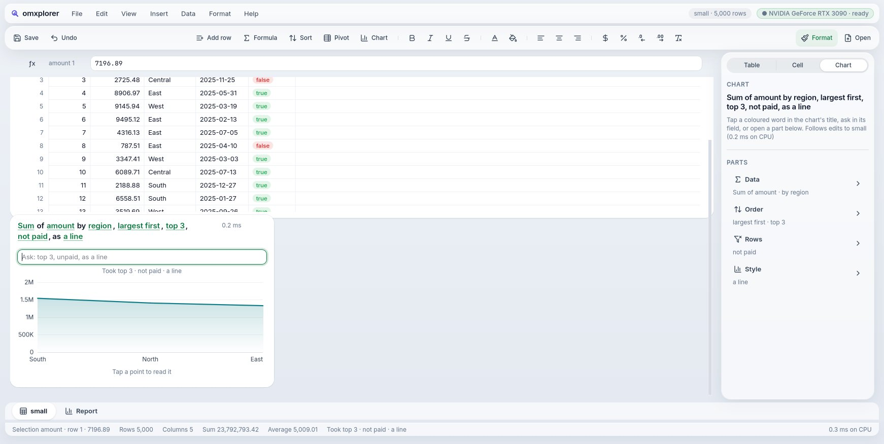

# Sentence charts



*A chart's title is its settings as a sentence. Ask in plain words and the words that changed glow.*

- A chart's title is a sentence, such as **Sum** of **amount** by **region**, **every region**, as **bars**.
- Tap a coloured word to change it, or type an ask under the chart: "top 3, unpaid, as a line".
- The bars move to their new place, and each change is one Undo step.

In the checks, 37 phrases are tested, and median, p90, number conditions and calendar groups equal pyarrow's. At 1
million rows a sum chart took 0.5 ms and a median 6.4 ms.

## How to try it

```sh
scripts/omxplorer.sh path/to/orders.csv
```

Insert → Chart, then tap "Sum" in its title, or type in Ask: *top 5, largest first, as a line*. Ctrl+Z steps back.

## Not there yet

- The ask reads English keywords; it is a keyword reader, not a model.
- One number condition per chart; no weeks or years as groups; p90 is the only percentile besides the median.
- "(blank)" groups have no median yet.
- At goal 28, iPhone and Android drew the sentence's words as plain buttons. A later goal laid out 42 chart sentences
  on a Mac with no word squeezed; the phones were not rechecked.

<sub>Source: docs/goals/28-report.md; docs/goals/29-report.md; docs/goals/56-report.md (M1).</sub>
