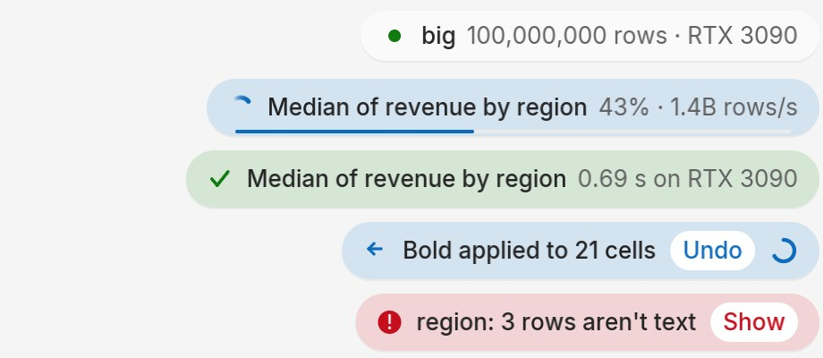

# Undo

*The island's Undo face: "Bold applied to 21 cells · Undo".*

- Ctrl+Z takes back one step at a time: cell edits, new rows, formula columns, formatting and chart changes, in order.
- The island offers Undo after an operation, and its Recent panel lists each operation with its own Undo.
- It works on files bigger than memory too.

In the checks, Undo took back a chart's ask, then an added row, then an earlier ask, one step each. On 100 million
streamed rows it took back a formula column, then a new row.

## How to try it

Make a change and press Ctrl+Z, or tap **Undo** on the island. Tap the island to open Recent.

## Not there yet

- Undo won't take back a formula column that a chart, pivot or tile reads. It says which, so you can remove that first.

Source: docs/goals/28-report.md (M4); docs/goals/22-report.md (M2); docs/goals/30-report.md ("What you see").
