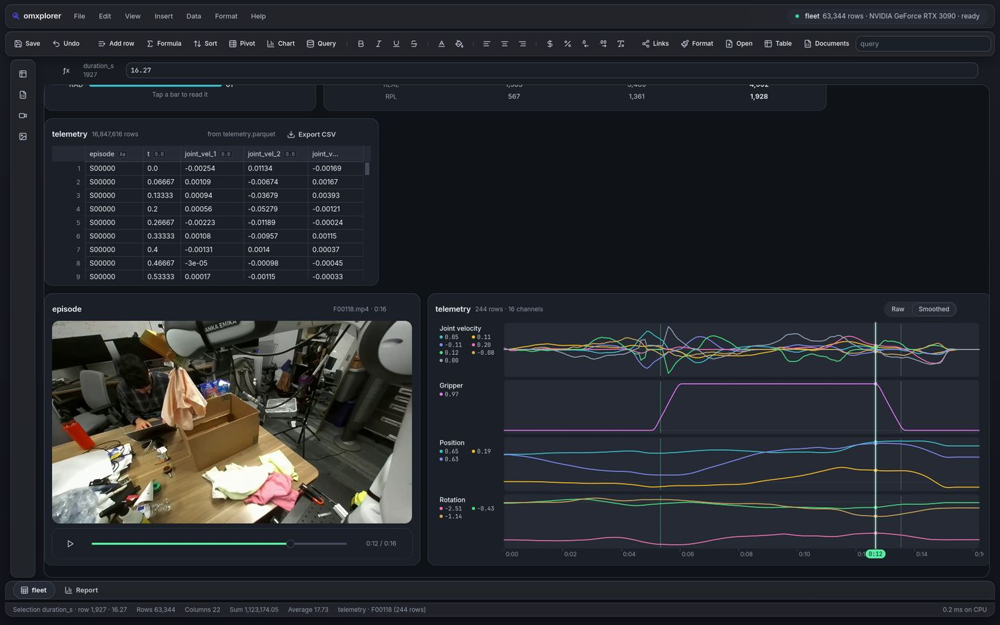

# Video and telemetry



*Episode F00118 from DROID: the video and four lanes of telemetry on one cursor, at the moment the gripper opens.*

- A robot episode's video plays beside its telemetry, drawn as lanes: joint velocities, gripper, position and rotation.
- One cursor drives both. Scrub the video and the lanes follow; the gripper's close and open are marked.
- Links decide which video and which rows follow a selected row in the sheet (see [[Links]]).

The demo uses DROID, a public dataset: 63,344 episodes from 13 labs, and 16,847,616 telemetry rows. The telemetry table
landed in 583.9 ms. One episode's 244 rows were sliced in 1.7 ms. No frame went over the 50 ms budget.

## How to try it

```sh
pixi run python -I scripts/robot_data.py build/g47/full   # fleet, telemetry, clips, paper
scripts/build.sh omxplorer linux
pixi run build/omxplorer/linux/omxplorer
```

1. **Open** → `build/g47/full/fleet.csv` → Create table.
2. **Table** → `telemetry.parquet`.
3. **Links** → type each and press Return: `fleet.episode = telemetry.episode`, `fleet.clip = episode.file`,
   `telemetry.t ~ episode.t +0`.
4. Click F00118 (row 1,927 of the fleet), seek to 0:08 and play.

## Not there yet

- DROID has no force or torque, so a drop is read from the gripper and the video.
- The gripper features (missed grasp, slip, regrasp) don't predict failure across labs; they are filters, not a detector.
- Only the left external camera was fetched; wrist and right views were not.
- Not run on the Mac. The web host was not done in this goal; a later goal opened the same story in the browser.

<sub>Source: docs/goals/47-report.md (M2, M7, "Record it yourself", "Not done"); docs/goals/62-report.md (M1, the web).</sub>
